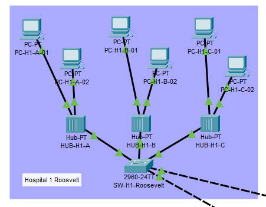
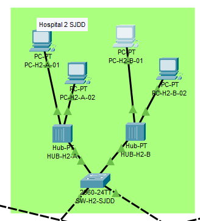
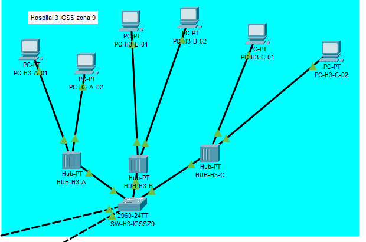
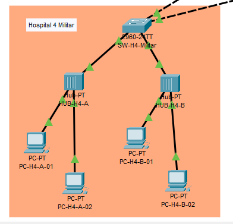
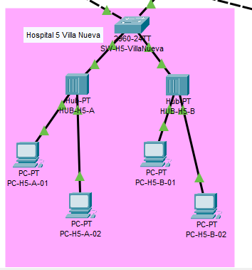
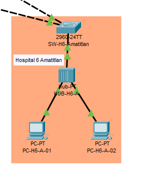
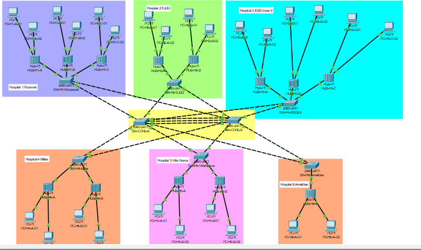

# Manual Tecnico

## Practica 2 - Red de Hospitales Metropolitano

### Redes de Computadoras 1
### Universidad de San Carlos de Guatemala
### Facultad de Ingenieria
### Ingenieria en Ciencias y Sistemas

---

## 1. Informacion general

**Estudiante:** Estuardo Josue Vaquiax Reyes  
**Carnet:** 202201336  
**Simulador:** Cisco Packet Tracer  
**Modelo de switch:** Cisco 2960  
**Archivo topologia:** Practica2_202201336_Final.pkt  
**Dominio VTP:** 202201336  
**Password VTP:** area1  
**VLAN nativa:** 99  
**VLAN blackhole:** 999

---

## 2. Objetivo y alcance

Se implemento una topologia de 6 hospitales reales del area metropolitana con:

1. Segmentacion por VLANs funcionales.
2. VTP (1 server y clientes).
3. STP Rapid PVST+.
4. EtherChannel PAgP de 3 enlaces fisicos entre switches core.
5. Subnetting contiguo y eficiente.
6. Asignacion IP en todas las computadoras usadas.
7. Pruebas de conectividad con evidencias.

Cumplimiento de enunciado aplicado:

1. Topologia robusta e hibrida de tres niveles.
2. Dominios de colision exactos por hospital.
3. VLAN nativa 99 en troncales.
4. VLAN 999 para puertos no utilizados.
5. Configuracion completa CLI por dispositivo.

---

## 3. Topologia implementada

### 3.1 Hospitales seleccionados

1. Hospital Roosevelt
2. Hospital General San Juan de Dios
3. IGSS Hospital General de Enfermedades (Zona 9)
4. Hospital Militar
5. Hospital de Especialidades de Villa Nueva
6. Hospital Nacional de Amatitlan

### 3.2 Arquitectura de red

1. Capa Core: SW-CORE-A y SW-CORE-B.
2. Capa Distribucion: SW-H1 a SW-H6.
3. Capa Acceso: hubs por hospital y laptops de muestra.

### 3.3 Dominios de colision exigidos

| Hospital | Hosts minimos | Dominios requeridos | Implementacion |
|---|---:|---:|---|
| H1 | 63 | 3 | 3 hubs |
| H2 | 25 | 2 | 2 hubs |
| H3 | 32 | 3 | 3 hubs |
| H4 | 15 | 2 | 2 hubs |
| H5 | 26 | 2 | 2 hubs |
| H6 | 8 | 1 | 1 hub |

### 3.4 Evidencia visual de topologia









---

## 4. Estandar de cableado (TIA/EIA-568B)

Aplicacion usada:

1. **Copper Straight-Through**:
- PC/Laptop <-> Hub
- Hub <-> Switch de hospital

2. **Copper Cross-Over**:
- Switch <-> Switch (core-core y hospital-core)


---

## 5. Diseno logico: VLANs y puertos

### 5.1 VLANs funcionales (formula por carnet X=6)

| Area | VLAN ID | Nombre |
|---|---:|---|
| 1 | 16 | QUIROFANO |
| 2 | 26 | UCI |
| 3 | 36 | ADMIN |
| 4 | 46 | FARMACIA |
| 5 | 56 | LAB |
| Seguridad | 99 | NATIVE |
| Seguridad | 999 | BLACKHOLE |

### 5.2 Mapeo final de puertos

**Core**

SW-CORE-A:

1. Fa0/7-9 <-> SW-CORE-B Fa0/7-9 (EtherChannel PAgP)
2. Fa0/4 <-> SW-H1-Roosevelt Fa0/4
3. Fa0/5 <-> SW-H2-SJDD Fa0/3
4. Fa0/6 <-> SW-H3-IGSSZ9 Fa0/4
5. Fa0/1 <-> SW-H4-Militar Fa0/3
6. Fa0/2 <-> SW-H5-VillaNueva Fa0/3
7. Fa0/3 <-> SW-H6-Amatitlan Fa0/2

SW-CORE-B:

1. Fa0/7-9 <-> SW-CORE-A Fa0/7-9 (EtherChannel PAgP)
2. Fa0/4 <-> SW-H1-Roosevelt Fa0/5
3. Fa0/5 <-> SW-H2-SJDD Fa0/4
4. Fa0/6 <-> SW-H3-IGSSZ9 Fa0/5
5. Fa0/1 <-> SW-H4-Militar Fa0/4
6. Fa0/2 <-> SW-H5-VillaNueva Fa0/4
7. Fa0/3 <-> SW-H6-Amatitlan Fa0/3

**Acceso por hospital**

SW-H1-Roosevelt:

1. Fa0/1 -> HUB-H1-A (VLAN 16)
2. Fa0/2 -> HUB-H1-B (VLAN 26)
3. Fa0/3 -> HUB-H1-C (VLAN 36)
4. Fa0/4 -> trunk a CORE-A
5. Fa0/5 -> trunk a CORE-B

SW-H2-SJDD:

1. Fa0/1 -> HUB-H2-A (VLAN 16)
2. Fa0/2 -> HUB-H2-B (VLAN 46)
3. Fa0/3, Fa0/4 troncales

SW-H3-IGSSZ9:

1. Fa0/1 -> HUB-H3-A (VLAN 26)
2. Fa0/2 -> HUB-H3-B (VLAN 36)
3. Fa0/3 -> HUB-H3-C (VLAN 56)
4. Fa0/4, Fa0/5 troncales

SW-H4-Militar:

1. Fa0/1 -> HUB-H4-A (VLAN 16)
2. Fa0/2 -> HUB-H4-B (VLAN 46)
3. Fa0/3, Fa0/4 troncales

SW-H5-VillaNueva:

1. Fa0/1 -> HUB-H5-A (VLAN 26)
2. Fa0/2 -> HUB-H5-B (VLAN 56)
3. Fa0/3, Fa0/4 troncales

SW-H6-Amatitlan:

1. Fa0/1 -> HUB-H6-A (VLAN 36)
2. Fa0/2, Fa0/3 troncales

---

## 6. Subnetting y direccionamiento IP

### 6.1 Tabla de subnetting

| VLAN | Red | Prefijo | Mascara | Rango util | Gateway |
|---:|---|---:|---|---|---|
| 16 | 192.168.36.0 | /26 | 255.255.255.192 | 192.168.36.1 - 192.168.36.62 | 192.168.36.1 |
| 26 | 192.168.36.64 | /26 | 255.255.255.192 | 192.168.36.65 - 192.168.36.126 | 192.168.36.65 |
| 36 | 192.168.36.128 | /26 | 255.255.255.192 | 192.168.36.129 - 192.168.36.190 | 192.168.36.129 |
| 46 | 192.168.36.192 | /27 | 255.255.255.224 | 192.168.36.193 - 192.168.36.222 | 192.168.36.193 |
| 56 | 192.168.36.224 | /27 | 255.255.255.224 | 192.168.36.225 - 192.168.36.254 | 192.168.36.225 |

### 6.2 Tabla completa de IPs en laptops usadas

| Laptop | VLAN | IP | Mascara | Gateway |
|---|---:|---|---|---|
| PC-H1-A-01 | 16 | 192.168.36.10 | 255.255.255.192 | 192.168.36.1 |
| PC-H1-A-02 | 16 | 192.168.36.11 | 255.255.255.192 | 192.168.36.1 |
| PC-H2-A-01 | 16 | 192.168.36.12 | 255.255.255.192 | 192.168.36.1 |
| PC-H2-A-02 | 16 | 192.168.36.13 | 255.255.255.192 | 192.168.36.1 |
| PC-H4-A-01 | 16 | 192.168.36.14 | 255.255.255.192 | 192.168.36.1 |
| PC-H4-A-02 | 16 | 192.168.36.15 | 255.255.255.192 | 192.168.36.1 |
| PC-H1-B-01 | 26 | 192.168.36.70 | 255.255.255.192 | 192.168.36.65 |
| PC-H1-B-02 | 26 | 192.168.36.71 | 255.255.255.192 | 192.168.36.65 |
| PC-H3-A-01 | 26 | 192.168.36.72 | 255.255.255.192 | 192.168.36.65 |
| PC-H3-A-02 | 26 | 192.168.36.73 | 255.255.255.192 | 192.168.36.65 |
| PC-H5-A-01 | 26 | 192.168.36.74 | 255.255.255.192 | 192.168.36.65 |
| PC-H5-A-02 | 26 | 192.168.36.75 | 255.255.255.192 | 192.168.36.65 |
| PC-H1-C-01 | 36 | 192.168.36.130 | 255.255.255.192 | 192.168.36.129 |
| PC-H1-C-02 | 36 | 192.168.36.131 | 255.255.255.192 | 192.168.36.129 |
| PC-H3-B-01 | 36 | 192.168.36.132 | 255.255.255.192 | 192.168.36.129 |
| PC-H3-B-02 | 36 | 192.168.36.133 | 255.255.255.192 | 192.168.36.129 |
| PC-H6-A-01 | 36 | 192.168.36.134 | 255.255.255.192 | 192.168.36.129 |
| PC-H6-A-02 | 36 | 192.168.36.135 | 255.255.255.192 | 192.168.36.129 |
| PC-H2-B-01 | 46 | 192.168.36.194 | 255.255.255.224 | 192.168.36.193 |
| PC-H2-B-02 | 46 | 192.168.36.195 | 255.255.255.224 | 192.168.36.193 |
| PC-H4-B-01 | 46 | 192.168.36.196 | 255.255.255.224 | 192.168.36.193 |
| PC-H4-B-02 | 46 | 192.168.36.197 | 255.255.255.224 | 192.168.36.193 |
| PC-H3-C-01 | 56 | 192.168.36.226 | 255.255.255.224 | 192.168.36.225 |
| PC-H3-C-02 | 56 | 192.168.36.227 | 255.255.255.224 | 192.168.36.225 |
| PC-H5-B-01 | 56 | 192.168.36.228 | 255.255.255.224 | 192.168.36.225 |
| PC-H5-B-02 | 56 | 192.168.36.229 | 255.255.255.224 | 192.168.36.225 |

---

## 7. Configuracion completa de switches (CLI)

El script completo usado en la implementacion esta en:

- `Practica2/CLI_Copiar_Pegar_Mapeo_Final.txt`

Para cumplir documentacion de detalle completo, se resume por equipo:

1. Configuracion basica de seguridad: hostname, enable secret, line console, line vty, service password-encryption, banner.
2. VTP: server en SW-CORE-A y client en el resto.
3. VLANs: 16, 26, 36, 46, 56, 99, 999.
4. STP: rapid-pvst.
5. EtherChannel PAgP: Fa0/7-9 en ambos core, Port-channel 1.
6. Troncales: VLAN nativa 99 y allowed VLAN 16,26,36,46,56,99,999.
7. Accesos: puertos de hubs a su VLAN correspondiente.
8. Puertos no usados: VLAN 999 + shutdown.

Evidencia CLI sugerida (capturas):

1. `Practica2/images/cli_core_a.png`
   
2. `Practica2/images/cli_core_b.png`
3. `Practica2/images/cli_h1.png`
4. `Practica2/images/cli_h2.png`
5. `Practica2/images/cli_h3.png`
6. `Practica2/images/cli_h4.png`
7. `Practica2/images/cli_h5.png`
8. `Practica2/images/cli_h6.png`

---

## 8. Verificacion de funcionamiento

### 8.1 Estado VLAN y troncales

Resultado observado:

1. VLANs creadas y propagadas por VTP en H1-H6.
2. Troncales activas y con VLAN nativa 99.
3. VLAN 999 asignada en puertos no usados.

Comandos usados:

```bash
show vlan brief
show interfaces trunk
show spanning-tree summary
show spanning-tree vlan 16
show spanning-tree vlan 26
show spanning-tree vlan 36
show spanning-tree vlan 46
show spanning-tree vlan 56
show vtp status
```

### 8.2 EtherChannel

Resultado observado en ambos core:

- `show etherchannel summary` reporta `Po1(SU)` con `Fa0/7(P) Fa0/8(P) Fa0/9(P)`.

Comandos usados:

```bash
show etherchannel summary
show interfaces trunk
show interfaces port-channel 1
```

Nota de compatibilidad Packet Tracer:

1. En algunas versiones, comandos como `show pagp neighbor` o `show spanning-tree root` pueden no estar soportados.
2. Debe ejecutarse `enable` primero para entrar a modo privilegiado (`#`).

### 8.3 Pings de validacion

Se realizaron pruebas exactamente con el criterio del enunciado:

1. Pings entre equipos de misma VLAN: **exitosos**.
2. Pings entre equipos de diferente VLAN: **fallidos** (esperado en red L2 sin router inter-VLAN).

Tabla de pruebas registradas:

| Origen | Destino | VLAN origen | VLAN destino | Resultado esperado | Resultado obtenido |
|---|---|---:|---:|---|---|
| 192.168.36.10 | 192.168.36.12 | 16 | 16 | Exitoso | Exitoso |
| 192.168.36.10 | 192.168.36.14 | 16 | 16 | Exitoso | Exitoso |
| 192.168.36.70 | 192.168.36.72 | 26 | 26 | Exitoso | Exitoso |
| 192.168.36.70 | 192.168.36.74 | 26 | 26 | Exitoso | Exitoso |
| 192.168.36.130 | 192.168.36.132 | 36 | 36 | Exitoso | Exitoso |
| 192.168.36.130 | 192.168.36.134 | 36 | 36 | Exitoso | Exitoso |
| 192.168.36.194 | 192.168.36.196 | 46 | 46 | Exitoso | Exitoso |
| 192.168.36.226 | 192.168.36.228 | 56 | 56 | Exitoso | Exitoso |
| 192.168.36.10 | 192.168.36.70 | 16 | 26 | Fallo | Fallo |
| 192.168.36.130 | 192.168.36.226 | 36 | 56 | Fallo | Fallo |

Capturas de ping:

.png)
.png)
.png)
.png)
.png)
.png)
.png)
.png)
.png)
.png)
---

## 9. Analisis ARP e ICMP en modo simulacion

### 9.1 Procedimiento

1. Cambiar a modo **Simulation**.
2. Filtrar protocolos: ARP e ICMP.
3. Ejecutar un ping entre dos equipos de la misma VLAN.
4. Observar primero ARP Request/Reply y luego ICMP Echo/Echo Reply.

### 9.2 Interpretacion tecnica

1. ARP resuelve la direccion MAC destino dentro del dominio de broadcast de la VLAN.
2. ICMP confirma conectividad de capa 3 dentro de la subred configurada.
3. Entre VLANs distintas, sin equipo de enrutamiento, el trafico ICMP no tiene camino y falla.


---

## 10. Cumplimiento de rubrica

| Criterio | Estado | Evidencia |
|---|---|---|
| Topologia organizada y robusta | Cumple | Seccion 3 + capturas |
| Configuracion CLI completa | Cumple | Seccion 7 + script CLI |
| IPs segun subnetting | Cumple | Seccion 6 |
| Pruebas de conectividad | Cumple | Seccion 8.3 |
| Estandar TIA/EIA-568B | Cumple | Seccion 4 |
| VLAN nativa 99 y blackhole 999 | Cumple | Secciones 5 y 7 |
| VTP dominio/password correctos | Cumple | Seccion 8.1 |
| STP Rapid PVST+ | Cumple | Secciones 7 y 8.1 |
| EtherChannel PAgP de 3 enlaces | Cumple | Seccion 8.2 |

---


## 11. Conclusiones

1. La red fue implementada con exito y cumple requisitos tecnicos del enunciado.
2. Se verifico segmentacion correcta: comunica misma VLAN y bloquea inter-VLAN sin routing.
3. La configuracion de VTP, STP y EtherChannel se encuentra operativa.
4. La documentacion incluye topologia, subnetting, IPs, comandos y pruebas.

---

## 12. Anexos

### Anexo A - Script completo de configuracion

Archivo:

- `Practica2/Mapeo`

### Anexo B - Salidas de validacion

Se recomienda anexar en markdown o como capturas:

1. `show vlan brief` (H1-H6 y core)
2. `show interfaces trunk` (H1-H6 y core)
3. `show spanning-tree summary`
4. `show vtp status`
5. `show etherchannel summary` (core)


