# Manual Técnico — Proyecto 1: NetCore Academy
**Redes de Computadoras 1 — Universidad San Carlos de Guatemala**  
**Carnet:** 202201336  
**Fecha:** Marzo 2026

---

## Tabla de Contenidos

1. [Topología General](#1-topología-general)
2. [Topología por Edificio](#2-topología-por-edificio)
3. [Interfaces y Medios de Transmisión](#3-interfaces-y-medios-de-transmisión)
4. [Tabla de VLANs](#4-tabla-de-vlans)
5. [Dominios de Colisión por Área](#5-dominios-de-colisión-por-área)
6. [Dominios de Broadcast](#6-dominios-de-broadcast)
7. [Tabla de Direccionamiento IP](#7-tabla-de-direccionamiento-ip)
8. [Comandos por Dispositivo](#8-comandos-por-dispositivo)
9. [Pruebas de Ping](#9-pruebas-de-ping)
10. [Capturas de Verificación](#10-capturas-de-verificación)
11. [Presupuesto Estimado](#11-presupuesto-estimado)

---

## 1. Topología General

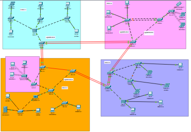

---

## 2. Topología por Edificio

### Edificio A

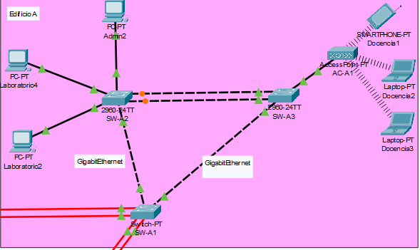

**Dispositivos:**
- **SW-A1** (Switch-PT) — VTP Server / Root Bridge
- **SW-A2** (2960-24TT) — Switch de acceso
- **SW-A3** (2960-24TT) — Switch de acceso
- **AC-A1** (AccessPoint-PT) — Punto de acceso inalámbrico VLAN DOCENTES
- Admin2, Laboratorio2, Laboratorio4 (PCs)
- Docencia1 (Smartphone), Docencia2, Docencia3 (Laptops)

---

### Edificio B

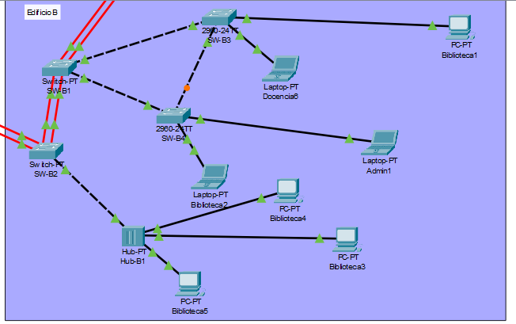

**Dispositivos:**
- **SW-B1** (Switch-PT) — VTP Client, punto de agregación
- **SW-B2** (Switch-PT) — VTP Client, punto de agregación
- **SW-B3** (2960-24TT) — Switch de acceso
- **SW-B4** (2960-24TT) — Switch de acceso
- **Hub-B1** (Hub-PT) — Segmento Legacy L1
- Biblioteca1, Biblioteca2, Biblioteca3, Biblioteca4, Biblioteca5 (PCs/Laptops)
- Docencia6 (Laptop), Admin1 (Laptop)

---

### Edificio C

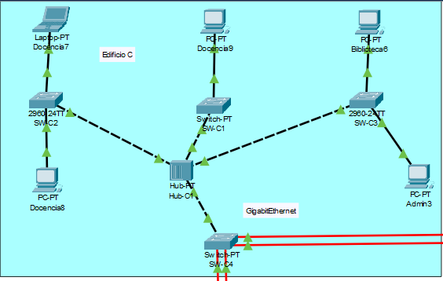

**Dispositivos:**
- **SW-C4** (Switch-PT) — VTP Client, punto de interconexión hacia campus
- **Hub-C1** (Hub-PT) — Núcleo del edificio, dispositivo Capa 1
- **SW-C1** (Switch-PT) — Switch de acceso
- **SW-C2** (2960-24TT) — Switch de acceso
- **SW-C3** (2960-24TT) — Switch de acceso
- Docencia7 (Laptop), Docencia8, Docencia9 (PCs)
- Biblioteca6, Admin3 (PCs)

---

### Edificio D

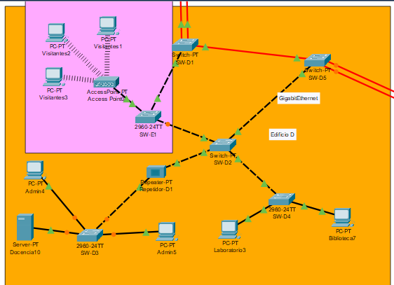

**Dispositivos:**
- **SW-D1** (Switch-PT) — VTP Client, IDF Armario de Piso
- **SW-D2** (Switch-PT) — VTP Client, capa de distribución
- **SW-D3** (2960-24TT) — VTP Client, switch de acceso
- **SW-D4** (2960-24TT) — VTP Client, switch de acceso
- **SW-D5** (Switch-PT) — VTP Client, interconexión con Edificio B
- **SW-E1** (2960-24TT) — **VTP Transparente**, área de visitantes
- **Repetidor-D1** (Repeater-PT) — Extensión física del medio Capa 1
- **AC-D1** (AccessPoint-PT) — Punto de acceso inalámbrico VLAN VISITANTE
- Visitantes1, Visitantes2, Visitantes3 (PCs)
- Admin4, Admin5 (PCs), Docencia10/Server, Laboratorio3, Biblioteca7

---

## 3. Interfaces y Medios de Transmisión

### Jerarquía de Medios

| Nivel | Segmento | Medio | Interfaz | Justificación |
|---|---|---|---|---|
| Interconexión de edificios | Entre switches de agregación | Fibra óptica OM3 (FFE) | FastEthernet (módulo fibra) | Mayor inmunidad al ruido, mayor alcance, permite EtherChannel |
| Distribución de edificio | Switches de área dentro del edificio | Cobre UTP Cat6 | GigabitEthernet | Soporta tráfico agregado de múltiples VLANs |
| Acceso a usuarios | PCs, laptops → switches de acceso | Cobre UTP Cat5e | FastEthernet | Suficiente para dispositivos finales |

### Tabla de Conexiones Inter-Edificios

| Enlace | Medio | Puerto Origen | Puerto Destino | Protocolo |
|---|---|---|---|---|
| SW-A1 ↔ SW-B1 | Fibra óptica (FFE x2) | Fa6/1, Fa7/1 | Fa5/1, Fa4/1 | EtherChannel LACP (Po2) |
| SW-A1 ↔ SW-C4 | Fibra óptica (FFE x2) | Fa4/1, Fa5/1 | Fa4/1, Fa5/1 | EtherChannel LACP (Po3) |
| SW-C4 ↔ SW-D1 | Fibra óptica (FFE x2) | Fa6/1, Fa9/1 | Fa4/1, Fa6/1 | EtherChannel LACP (Po2) |
| SW-D5 ↔ SW-B2 | Fibra óptica (FFE x2) | Fa4/1, Fa5/1 | Fa6/1, Fa9/1 | EtherChannel LACP (Po2) |
| SW-B1 ↔ SW-B2 | Fibra óptica (FFE x2) | Fa7/1, Fa6/1 | Fa5/1, Fa4/1 | EtherChannel LACP (Po1) |
| SW-D5 ↔ SW-D1 | Fibra óptica (FFE) | Gig0/1 | Gig7/1 | Trunk 802.1Q |

### Tabla de Conexiones Intra-Edificio

| Enlace | Medio | Puerto Origen | Puerto Destino | Protocolo |
|---|---|---|---|---|
| SW-A1 ↔ SW-A2 | Cobre UTP Cat6 | Gig3/1 | Gig0/1 | Trunk 802.1Q |
| SW-A1 ↔ SW-A3 | Cobre UTP Cat6 | Gig8/1 | Gig0/1 | Trunk 802.1Q |
| SW-A2 ↔ SW-A3 | Cobre UTP Cat6 | Fa0/2, Fa0/3 | Fa0/2, Fa0/3 | EtherChannel PAgP (Po1) |
| SW-B1 ↔ SW-B3 | Cobre UTP Cat6 | Gig9/1 | Gig0/1 | Trunk 802.1Q |
| SW-B1 ↔ SW-B4 | Cobre UTP Cat6 | Gig8/1 | Gig0/1 | Trunk 802.1Q |
| SW-C4 ↔ Hub-C1 | Cobre UTP Cat6 | Gig8/1 | — | GigabitEthernet |
| SW-D1 ↔ SW-E1 | Cobre UTP Cat5e | Fa0/1 | Fa0/2 | Trunk 802.1Q |
| SW-D2 ↔ SW-D4 | Cobre UTP Cat5e | Fa3/1 | Fa0/3 | Trunk 802.1Q |

---

## 4. Tabla de VLANs

| VLAN ID | Nombre | Área | Red Asignada |
|---|---|---|---|
| 16 | ADMIN | Administración | 192.168.16.0/24 |
| 26 | DOCENTES | Docencia | 192.168.16.0/24 |
| 36 | BIBLIOTECA | Biblioteca | 192.168.16.0/24 |
| 46 | LABORATORIO | Laboratorio de Redes | 192.168.16.0/24 |
| 56 | VISITANTE | Visitantes | 192.168.16.0/24 |

> **Nota:** La X del carnet es 6, por lo tanto la red base es 192.168.16.0/24 y los IDs de VLAN siguen el patrón X0 donde X=último dígito del carnet.

---

## 5. Dominios de Colisión por Área

Un dominio de colisión es un segmento de red donde dos dispositivos pueden causar una colisión al transmitir simultáneamente. Los switches crean un dominio de colisión por puerto, mientras que los hubs y repetidores comparten un único dominio.

### Edificio A

| # | Dominio de Colisión | Dispositivos |
|---|---|---|
| 1 | SW-A2 Fa0/4 | Admin2 |
| 2 | SW-A2 Fa0/5 | Laboratorio4 |
| 3 | SW-A2 Fa0/6 | Laboratorio2 |
| 4 | SW-A3 Fa0/4 | AC-A1 (y sus clientes inalámbricos) |
| 5 | SW-A2 ↔ SW-A3 (Po1) | Enlace EtherChannel |
| 6 | SW-A1 ↔ SW-A2 (Gig3/1) | Enlace troncal |
| 7 | SW-A1 ↔ SW-A3 (Gig8/1) | Enlace troncal |

**Total Edificio A: 7 dominios de colisión**

---

### Edificio B

| # | Dominio de Colisión | Dispositivos |
|---|---|---|
| 1 | SW-B3 Fa0/2 | Biblioteca1 |
| 2 | SW-B3 Fa0/3 | Docencia6 |
| 3 | SW-B4 Fa0/3 | Admin1 |
| 4 | SW-B4 Fa0/4 | Biblioteca2 |
| 5 | Hub-B1 (dominio compartido) | Biblioteca3, Biblioteca4, Biblioteca5 + SW-B2 |
| 6 | SW-B1 ↔ SW-B3 (Gig) | Enlace troncal |
| 7 | SW-B1 ↔ SW-B4 (Gig) | Enlace troncal |
| 8 | SW-B1 ↔ SW-B2 (Po1) | EtherChannel |

**Total Edificio B: 8 dominios de colisión**  
> ⚠️ El Hub-B1 crea un único dominio de colisión compartido entre todos sus puertos (Biblioteca3, Biblioteca4, Biblioteca5).

---

### Edificio C

| # | Dominio de Colisión | Dispositivos |
|---|---|---|
| 1 | Hub-C1 (dominio compartido) | SW-C1, SW-C2, SW-C3 + SW-C4 |
| 2 | SW-C1 Fa1/1 | Docencia9 |
| 3 | SW-C2 Fa0/1 | Docencia8 |
| 4 | SW-C2 Fa0/2 | Docencia7 |
| 5 | SW-C3 Fa0/2 | Biblioteca6 |
| 6 | SW-C3 Fa0/3 | Admin3 |

**Total Edificio C: 6 dominios de colisión**  
> ⚠️ El Hub-C1 crea un único dominio de colisión compartido que incluye todos los switches SW-C1, SW-C2 y SW-C3.

---

### Edificio D

| # | Dominio de Colisión | Dispositivos |
|---|---|---|
| 1 | SW-E1 Gig0/2 | Access Point0 (clientes visitantes inalámbricos) |
| 2 | SW-E1 Fa0/1 | AC-D1 (clientes visitantes inalámbricos) |
| 3 | Repetidor-D1 (dominio compartido) | SW-D2 Fa1/1 + SW-D3 Fa0/4 |
| 4 | SW-D3 Fa0/1 | Admin5 |
| 5 | SW-D3 Fa0/2 | Admin4 |
| 6 | SW-D3 Fa0/3 | Docencia10/Server |
| 7 | SW-D4 Fa0/1 | Laboratorio3 |
| 8 | SW-D4 Fa0/2 | Biblioteca7 |
| 9 | SW-D1 ↔ SW-E1 | Enlace troncal |
| 10 | SW-D1 ↔ SW-D5 (Gig7/1) | Enlace troncal |

**Total Edificio D: 10 dominios de colisión**  
> ⚠️ El Repetidor-D1 extiende el dominio de colisión entre SW-D2 y SW-D3.

---

## 6. Dominios de Broadcast

Un dominio de broadcast es el conjunto de dispositivos que reciben tramas broadcast enviadas por cualquier miembro. En este proyecto cada VLAN constituye un dominio de broadcast separado a lo largo de todo el campus.

### VLAN 16 — ADMIN (Dominio de Broadcast 1)

| Dispositivo | Edificio | Puerto Switch |
|---|---|---|
| Admin2 | A | SW-A2 Fa0/4 |
| Admin1 | B | SW-B4 Fa0/3 |
| Admin3 | C | SW-C3 Fa0/3 |
| Admin4 | D | SW-D3 Fa0/2 |
| Admin5 | D | SW-D3 Fa0/1 |

---

### VLAN 26 — DOCENTES (Dominio de Broadcast 2)

| Dispositivo | Edificio | Puerto Switch |
|---|---|---|
| Docencia1 (Smartphone) | A | AC-A1 (inalámbrico) |
| Docencia2 (Laptop) | A | AC-A1 (inalámbrico) |
| Docencia3 (Laptop) | A | AC-A1 (inalámbrico) |
| Docencia6 (Laptop) | B | SW-B3 Fa0/3 |
| Docencia7 (Laptop) | C | SW-C2 Fa0/2 |
| Docencia8 | C | SW-C2 Fa0/1 |
| Docencia9 | C | SW-C1 Fa1/1 |
| Docencia10/Server | D | SW-D3 Fa0/3 |

---

### VLAN 36 — BIBLIOTECA (Dominio de Broadcast 3)

| Dispositivo | Edificio | Puerto Switch |
|---|---|---|
| Biblioteca1 | B | SW-B3 Fa0/2 |
| Biblioteca2 (Laptop) | B | SW-B4 Fa0/4 |
| Biblioteca3 | B | Hub-B1 |
| Biblioteca4 | B | Hub-B1 |
| Biblioteca5 | B | Hub-B1 |
| Biblioteca6 | C | SW-C3 Fa0/2 |
| Biblioteca7 | D | SW-D4 Fa0/2 |

---

### VLAN 46 — LABORATORIO (Dominio de Broadcast 4)

| Dispositivo | Edificio | Puerto Switch |
|---|---|---|
| Laboratorio2 | A | SW-A2 Fa0/6 |
| Laboratorio4 | A | SW-A2 Fa0/5 |
| Laboratorio3 | D | SW-D4 Fa0/1 |

---

### VLAN 56 — VISITANTE (Dominio de Broadcast 5)

| Dispositivo | Edificio | Puerto Switch |
|---|---|---|
| Visitantes1 | D | AC-D1 / Access Point0 (inalámbrico) |
| Visitantes2 | D | AC-D1 / Access Point0 (inalámbrico) |
| Visitantes3 | D | AC-D1 / Access Point0 (inalámbrico) |

---

## 7. Tabla de Direccionamiento IP

| Dispositivo | Edificio | VLAN | IP | Máscara | Gateway |
|---|---|---|---|---|---|
| Admin2 | A | ADMIN (16) | 192.168.16.1 | 255.255.255.0 | — |
| Laboratorio4 | A | LABORATORIO (46) | 192.168.16.2 | 255.255.255.0 | — |
| Laboratorio2 | A | LABORATORIO (46) | 192.168.16.3 | 255.255.255.0 | — |
| Docencia1 (Smartphone) | A | DOCENTES (26) | 192.168.16.4 | 255.255.255.0 | — |
| Docencia2 (Laptop) | A | DOCENTES (26) | 192.168.16.5 | 255.255.255.0 | — |
| Docencia3 (Laptop) | A | DOCENTES (26) | 192.168.16.6 | 255.255.255.0 | — |
| Biblioteca1 | B | BIBLIOTECA (36) | 192.168.16.10 | 255.255.255.0 | — |
| Docencia6 (Laptop) | B | DOCENTES (26) | 192.168.16.11 | 255.255.255.0 | — |
| Admin1 (Laptop) | B | ADMIN (16) | 192.168.16.12 | 255.255.255.0 | — |
| Biblioteca2 (Laptop) | B | BIBLIOTECA (36) | 192.168.16.13 | 255.255.255.0 | — |
| Biblioteca3 | B | BIBLIOTECA (36) | 192.168.16.14 | 255.255.255.0 | — |
| Biblioteca4 | B | BIBLIOTECA (36) | 192.168.16.15 | 255.255.255.0 | — |
| Biblioteca5 | B | BIBLIOTECA (36) | 192.168.16.16 | 255.255.255.0 | — |
| Docencia7 (Laptop) | C | DOCENTES (26) | 192.168.16.20 | 255.255.255.0 | — |
| Docencia8 | C | DOCENTES (26) | 192.168.16.21 | 255.255.255.0 | — |
| Docencia9 | C | DOCENTES (26) | 192.168.16.22 | 255.255.255.0 | — |
| Biblioteca6 | C | BIBLIOTECA (36) | 192.168.16.23 | 255.255.255.0 | — |
| Admin3 | C | ADMIN (16) | 192.168.16.24 | 255.255.255.0 | — |
| Visitantes1 | D | VISITANTE (56) | 192.168.16.30 | 255.255.255.0 | — |
| Visitantes2 | D | VISITANTE (56) | 192.168.16.31 | 255.255.255.0 | — |
| Visitantes3 | D | VISITANTE (56) | 192.168.16.32 | 255.255.255.0 | — |
| Admin4 | D | ADMIN (16) | 192.168.16.33 | 255.255.255.0 | — |
| Admin5 | D | ADMIN (16) | 192.168.16.34 | 255.255.255.0 | — |
| Docencia10/Server | D | DOCENTES (26) | 192.168.16.35 | 255.255.255.0 | — |
| Laboratorio3 | D | LABORATORIO (46) | 192.168.16.36 | 255.255.255.0 | — |
| Biblioteca7 | D | BIBLIOTECA (36) | 192.168.16.37 | 255.255.255.0 | — |

> **Nota:** No se configura gateway porque este proyecto es exclusivamente Capa 2. No existe enrutamiento inter-VLAN.

---

## 8. Comandos por Dispositivo

### SW-A1 — VTP Server / Root Bridge

```
enable
configure terminal
hostname SW-A1
banner motd #
Bienvenido a Edificio A - NETCORE_202201336
#
enable secret cisco
line console 0
 password cisco
 login
exit
line vty 0 4
 password cisco
 login
exit
service password-encryption
vtp mode server
vtp domain C3_NetCore
vtp version 2
vlan 16
 name ADMIN
vlan 26
 name DOCENTES
vlan 36
 name BIBLIOTECA
vlan 46
 name LABORATORIO
vlan 56
 name VISITANTE
spanning-tree mode pvst
spanning-tree vlan 1 priority 4096
spanning-tree vlan 16 priority 4096
spanning-tree vlan 26 priority 4096
spanning-tree vlan 36 priority 4096
spanning-tree vlan 46 priority 4096
spanning-tree vlan 56 priority 4096
interface GigabitEthernet3/1
 switchport mode trunk
 switchport trunk allowed vlan 16,26,36,46,56
 no shutdown
interface GigabitEthernet8/1
 switchport mode trunk
 switchport trunk allowed vlan 16,26,36,46,56
 no shutdown
interface FastEthernet6/1
 switchport mode trunk
 switchport trunk allowed vlan 16,26,36,46,56
 channel-group 2 mode active
 no shutdown
interface FastEthernet7/1
 switchport mode trunk
 switchport trunk allowed vlan 16,26,36,46,56
 channel-group 2 mode active
 no shutdown
interface Port-channel2
 switchport mode trunk
 switchport trunk allowed vlan 16,26,36,46,56
interface FastEthernet4/1
 switchport mode trunk
 switchport trunk allowed vlan 16,26,36,46,56
 channel-group 3 mode active
 no shutdown
interface FastEthernet5/1
 switchport mode trunk
 switchport trunk allowed vlan 16,26,36,46,56
 channel-group 3 mode active
 no shutdown
interface Port-channel3
 switchport mode trunk
 switchport trunk allowed vlan 16,26,36,46,56
vtp password proyecto12026
end
write memory
```

---

### SW-A2 — VTP Client, Edificio A

```
enable
configure terminal
hostname SW-A2
banner motd #
Bienvenido a Edificio A - NETCORE_202201336
#
enable secret cisco
line console 0
 password cisco
 login
exit
line vty 0 4
 password cisco
 login
exit
service password-encryption
vtp mode client
vtp domain C3_NetCore
spanning-tree mode pvst
interface FastEthernet0/2
 switchport mode trunk
 switchport trunk allowed vlan 16,26,36,46,56
 channel-group 1 mode desirable
 no shutdown
interface FastEthernet0/3
 switchport mode trunk
 switchport trunk allowed vlan 16,26,36,46,56
 channel-group 1 mode desirable
 no shutdown
interface Port-channel1
 switchport mode trunk
 switchport trunk allowed vlan 16,26,36,46,56
interface GigabitEthernet0/1
 switchport mode trunk
 switchport trunk allowed vlan 16,26,36,46,56
 no shutdown
interface FastEthernet0/4
 switchport mode access
 switchport access vlan 16
 no shutdown
interface FastEthernet0/5
 switchport mode access
 switchport access vlan 46
 no shutdown
interface FastEthernet0/6
 switchport mode access
 switchport access vlan 46
 no shutdown
vtp password proyecto12026
end
write memory
```

---

### SW-A3 — VTP Client, Edificio A

```
enable
configure terminal
hostname SW-A3
banner motd #
Bienvenido a Edificio A - NETCORE_202201336
#
enable secret cisco
line console 0
 password cisco
 login
exit
line vty 0 4
 password cisco
 login
exit
service password-encryption
vtp mode client
vtp domain C3_NetCore
spanning-tree mode pvst
interface FastEthernet0/2
 switchport mode trunk
 switchport trunk allowed vlan 16,26,36,46,56
 channel-group 1 mode desirable
 no shutdown
interface FastEthernet0/3
 switchport mode trunk
 switchport trunk allowed vlan 16,26,36,46,56
 channel-group 1 mode desirable
 no shutdown
interface Port-channel1
 switchport mode trunk
 switchport trunk allowed vlan 16,26,36,46,56
interface GigabitEthernet0/1
 switchport mode trunk
 switchport trunk allowed vlan 16,26,36,46,56
 no shutdown
interface FastEthernet0/4
 switchport mode access
 switchport access vlan 26
 no shutdown
vtp password proyecto12026
end
write memory
```

---

### SW-B1 — VTP Client, Edificio B

```
enable
configure terminal
hostname SW-B1
banner motd #
Bienvenido a Edificio B - NETCORE_202201336
#
enable secret cisco
line console 0
 password cisco
 login
exit
line vty 0 4
 password cisco
 login
exit
service password-encryption
vtp mode client
vtp domain C3_NetCore
spanning-tree mode pvst
interface FastEthernet7/1
 switchport mode trunk
 switchport trunk allowed vlan 16,26,36,46,56
 channel-group 1 mode active
 no shutdown
interface FastEthernet6/1
 switchport mode trunk
 switchport trunk allowed vlan 16,26,36,46,56
 channel-group 1 mode active
 no shutdown
interface Port-channel1
 switchport mode trunk
 switchport trunk allowed vlan 16,26,36,46,56
interface FastEthernet4/1
 switchport mode trunk
 switchport trunk allowed vlan 16,26,36,46,56
 no shutdown
interface FastEthernet5/1
 switchport mode trunk
 switchport trunk allowed vlan 16,26,36,46,56
 no shutdown
interface GigabitEthernet8/1
 switchport mode trunk
 switchport trunk allowed vlan 16,26,36,46,56
 no shutdown
interface GigabitEthernet9/1
 switchport mode trunk
 switchport trunk allowed vlan 16,26,36,46,56
 no shutdown
vtp password proyecto12026
end
write memory
```

---

### SW-B2 — VTP Client, Edificio B

```
enable
configure terminal
hostname SW-B2
banner motd #
Bienvenido a Edificio B - NETCORE_202201336
#
enable secret cisco
line console 0
 password cisco
 login
exit
line vty 0 4
 password cisco
 login
exit
service password-encryption
vtp mode client
vtp domain C3_NetCore
spanning-tree mode pvst
interface FastEthernet5/1
 switchport mode trunk
 switchport trunk allowed vlan 16,26,36,46,56
 channel-group 1 mode active
 no shutdown
interface FastEthernet4/1
 switchport mode trunk
 switchport trunk allowed vlan 16,26,36,46,56
 channel-group 1 mode active
 no shutdown
interface Port-channel1
 switchport mode trunk
 switchport trunk allowed vlan 16,26,36,46,56
interface FastEthernet9/1
 switchport mode trunk
 switchport trunk allowed vlan 16,26,36,46,56
 channel-group 2 mode active
 no shutdown
interface FastEthernet6/1
 switchport mode trunk
 switchport trunk allowed vlan 16,26,36,46,56
 channel-group 2 mode active
 no shutdown
interface Port-channel2
 switchport mode trunk
 switchport trunk allowed vlan 16,26,36,46,56
interface FastEthernet0/1
 switchport mode access
 switchport access vlan 36
 no shutdown
vtp password proyecto12026
end
write memory
```

---

### SW-B3 — VTP Client, Edificio B

```
enable
configure terminal
hostname SW-B3
banner motd #
Bienvenido a Edificio B - NETCORE_202201336
#
enable secret cisco
line console 0
 password cisco
 login
exit
line vty 0 4
 password cisco
 login
exit
service password-encryption
vtp mode client
vtp domain C3_NetCore
spanning-tree mode pvst
interface GigabitEthernet0/1
 switchport mode trunk
 switchport trunk allowed vlan 16,26,36,46,56
 no shutdown
interface FastEthernet0/4
 switchport mode trunk
 switchport trunk allowed vlan 16,26,36,46,56
 no shutdown
interface FastEthernet0/2
 switchport mode access
 switchport access vlan 36
 no shutdown
interface FastEthernet0/3
 switchport mode access
 switchport access vlan 26
 no shutdown
vtp password proyecto12026
end
write memory
```

---

### SW-B4 — VTP Client, Edificio B

```
enable
configure terminal
hostname SW-B4
banner motd #
Bienvenido a Edificio B - NETCORE_202201336
#
enable secret cisco
line console 0
 password cisco
 login
exit
line vty 0 4
 password cisco
 login
exit
service password-encryption
vtp mode client
vtp domain C3_NetCore
spanning-tree mode pvst
interface GigabitEthernet0/1
 switchport mode trunk
 switchport trunk allowed vlan 16,26,36,46,56
 no shutdown
interface FastEthernet0/2
 switchport mode trunk
 switchport trunk allowed vlan 16,26,36,46,56
 no shutdown
interface FastEthernet0/3
 switchport mode access
 switchport access vlan 16
 no shutdown
interface FastEthernet0/4
 switchport mode access
 switchport access vlan 36
 no shutdown
vtp password proyecto12026
end
write memory
```

---

### SW-C4 — VTP Client, Edificio C

```
enable
configure terminal
hostname SW-C4
banner motd #
Bienvenido a Edificio C - NETCORE_202201336
#
enable secret cisco
line console 0
 password cisco
 login
exit
line vty 0 4
 password cisco
 login
exit
service password-encryption
vtp mode client
vtp domain C3_NetCore
spanning-tree mode pvst
interface GigabitEthernet8/1
 switchport mode trunk
 switchport trunk allowed vlan 16,26,36,46,56
 no shutdown
interface FastEthernet4/1
 switchport mode trunk
 switchport trunk allowed vlan 16,26,36,46,56
 channel-group 1 mode active
 no shutdown
interface FastEthernet5/1
 switchport mode trunk
 switchport trunk allowed vlan 16,26,36,46,56
 channel-group 1 mode active
 no shutdown
interface Port-channel1
 switchport mode trunk
 switchport trunk allowed vlan 16,26,36,46,56
interface FastEthernet6/1
 switchport mode trunk
 switchport trunk allowed vlan 16,26,36,46,56
 channel-group 2 mode active
 no shutdown
interface FastEthernet9/1
 switchport mode trunk
 switchport trunk allowed vlan 16,26,36,46,56
 channel-group 2 mode active
 no shutdown
interface Port-channel2
 switchport mode trunk
 switchport trunk allowed vlan 16,26,36,46,56
vtp password proyecto12026
end
write memory
```

---

### SW-C1 — VTP Client, Edificio C

```
enable
configure terminal
hostname SW-C1
banner motd #
Bienvenido a Edificio C - NETCORE_202201336
#
enable secret cisco
line console 0
 password cisco
 login
exit
line vty 0 4
 password cisco
 login
exit
service password-encryption
vtp mode client
vtp domain C3_NetCore
spanning-tree mode pvst
interface FastEthernet0/1
 switchport mode trunk
 switchport trunk allowed vlan 16,26,36,46,56
 no shutdown
interface FastEthernet1/1
 switchport mode access
 switchport access vlan 26
 no shutdown
vtp password proyecto12026
end
write memory
```

---

### SW-C2 — VTP Client, Edificio C

```
enable
configure terminal
hostname SW-C2
banner motd #
Bienvenido a Edificio C - NETCORE_202201336
#
enable secret cisco
line console 0
 password cisco
 login
exit
line vty 0 4
 password cisco
 login
exit
service password-encryption
vtp mode client
vtp domain C3_NetCore
spanning-tree mode pvst
interface FastEthernet0/3
 switchport mode trunk
 switchport trunk allowed vlan 16,26,36,46,56
 no shutdown
interface FastEthernet0/1
 switchport mode access
 switchport access vlan 26
 no shutdown
interface FastEthernet0/2
 switchport mode access
 switchport access vlan 26
 no shutdown
vtp password proyecto12026
end
write memory
```

---

### SW-C3 — VTP Client, Edificio C

```
enable
configure terminal
hostname SW-C3
banner motd #
Bienvenido a Edificio C - NETCORE_202201336
#
enable secret cisco
line console 0
 password cisco
 login
exit
line vty 0 4
 password cisco
 login
exit
service password-encryption
vtp mode client
vtp domain C3_NetCore
spanning-tree mode pvst
interface FastEthernet0/1
 switchport mode trunk
 switchport trunk allowed vlan 16,26,36,46,56
 no shutdown
interface FastEthernet0/2
 switchport mode access
 switchport access vlan 36
 no shutdown
interface FastEthernet0/3
 switchport mode access
 switchport access vlan 16
 no shutdown
vtp password proyecto12026
end
write memory
```

---

### SW-D1 — VTP Client, Edificio D (IDF)

```
enable
configure terminal
hostname SW-D1
banner motd #
Bienvenido a Edificio D - NETCORE_202201336
#
enable secret cisco
line console 0
 password cisco
 login
exit
line vty 0 4
 password cisco
 login
exit
service password-encryption
vtp mode client
vtp domain C3_NetCore
spanning-tree mode pvst
interface FastEthernet4/1
 switchport mode trunk
 switchport trunk allowed vlan 16,26,36,46,56
 channel-group 1 mode active
 no shutdown
interface FastEthernet6/1
 switchport mode trunk
 switchport trunk allowed vlan 16,26,36,46,56
 channel-group 1 mode active
 no shutdown
interface Port-channel1
 switchport mode trunk
 switchport trunk allowed vlan 16,26,36,46,56
interface GigabitEthernet7/1
 switchport mode trunk
 switchport trunk allowed vlan 16,26,36,46,56
 no shutdown
interface FastEthernet0/1
 switchport mode trunk
 switchport trunk allowed vlan 16,26,36,46,56
 no shutdown
vtp password proyecto12026
end
write memory
```

---

### SW-D2 — VTP Client, Edificio D

```
enable
configure terminal
hostname SW-D2
banner motd #
Bienvenido a Edificio D - NETCORE_202201336
#
enable secret cisco
line console 0
 password cisco
 login
exit
line vty 0 4
 password cisco
 login
exit
service password-encryption
vtp mode client
vtp domain C3_NetCore
spanning-tree mode pvst
interface GigabitEthernet9/1
 switchport mode trunk
 switchport trunk allowed vlan 16,26,36,46,56
 no shutdown
interface FastEthernet0/1
 switchport mode trunk
 switchport trunk allowed vlan 16,26,36,46,56
 no shutdown
interface FastEthernet3/1
 switchport mode trunk
 switchport trunk allowed vlan 16,26,36,46,56
 no shutdown
interface FastEthernet1/1
 switchport mode access
 switchport access vlan 16
 no shutdown
vtp password proyecto12026
end
write memory
```

---

### SW-D3 — VTP Client, Edificio D

```
enable
configure terminal
hostname SW-D3
banner motd #
Bienvenido a Edificio D - NETCORE_202201336
#
enable secret cisco
line console 0
 password cisco
 login
exit
line vty 0 4
 password cisco
 login
exit
service password-encryption
vtp mode client
vtp domain C3_NetCore
spanning-tree mode pvst
interface FastEthernet0/4
 switchport mode access
 switchport access vlan 16
 no shutdown
interface FastEthernet0/1
 switchport mode access
 switchport access vlan 16
 no shutdown
interface FastEthernet0/2
 switchport mode access
 switchport access vlan 16
 no shutdown
interface FastEthernet0/3
 switchport mode access
 switchport access vlan 26
 no shutdown
vtp password proyecto12026
end
write memory
```

---

### SW-D4 — VTP Client, Edificio D

```
enable
configure terminal
hostname SW-D4
banner motd #
Bienvenido a Edificio D - NETCORE_202201336
#
enable secret cisco
line console 0
 password cisco
 login
exit
line vty 0 4
 password cisco
 login
exit
service password-encryption
vtp mode client
vtp domain C3_NetCore
spanning-tree mode pvst
interface FastEthernet0/3
 switchport mode trunk
 switchport trunk allowed vlan 16,26,36,46,56
 no shutdown
interface FastEthernet0/1
 switchport mode access
 switchport access vlan 46
 no shutdown
interface FastEthernet0/2
 switchport mode access
 switchport access vlan 36
 no shutdown
vtp password proyecto12026
end
write memory
```

---

### SW-D5 — VTP Client, Edificio D

```
enable
configure terminal
hostname SW-D5
banner motd #
Bienvenido a Edificio D - NETCORE_202201336
#
enable secret cisco
line console 0
 password cisco
 login
exit
line vty 0 4
 password cisco
 login
exit
service password-encryption
vtp mode client
vtp domain C3_NetCore
spanning-tree mode pvst
interface GigabitEthernet0/1
 switchport mode trunk
 switchport trunk allowed vlan 16,26,36,46,56
 no shutdown
interface GigabitEthernet9/1
 switchport mode trunk
 switchport trunk allowed vlan 16,26,36,46,56
 no shutdown
interface FastEthernet4/1
 switchport mode trunk
 switchport trunk allowed vlan 16,26,36,46,56
 channel-group 1 mode active
 no shutdown
interface FastEthernet5/1
 switchport mode trunk
 switchport trunk allowed vlan 16,26,36,46,56
 channel-group 1 mode active
 no shutdown
interface Port-channel1
 switchport mode trunk
 switchport trunk allowed vlan 16,26,36,46,56
vtp password proyecto12026
end
write memory
```

---

### SW-E1 — VTP Transparente, Edificio D

```
enable
configure terminal
hostname SW-E1
banner motd #
Bienvenido a Edificio D - NETCORE_202201336
#
enable secret cisco
line console 0
 password cisco
 login
exit
line vty 0 4
 password cisco
 login
exit
service password-encryption
vtp mode transparent
vtp domain C3_NetCore
vtp password proyecto12026
spanning-tree mode pvst
vlan 16
 name ADMIN
vlan 26
 name DOCENTES
vlan 36
 name BIBLIOTECA
vlan 46
 name LABORATORIO
vlan 56
 name VISITANTE
interface FastEthernet0/2
 switchport mode trunk
 switchport trunk allowed vlan 16,26,36,46,56
 no shutdown
interface FastEthernet0/3
 switchport mode trunk
 switchport trunk allowed vlan 16,26,36,46,56
 no shutdown
interface GigabitEthernet0/2
 switchport mode access
 switchport access vlan 56
 no shutdown
interface FastEthernet0/1
 switchport mode access
 switchport access vlan 56
 no shutdown
end
write memory
```

---

## 9. Pruebas de Ping

### Pings Exitosos (misma VLAN)


#### VLAN 16 — ADMIN 
**Desde:** Admin2 (Ed. A) `192.168.16.1`  
**Hacia:** Admin1 (Ed. B) `192.168.16.12`

```
ping 192.168.16.12
```

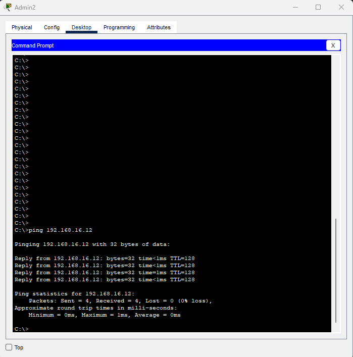

Resultado esperado:
```
Reply from 192.168.16.12: bytes=32 time<1ms TTL=128
Reply from 192.168.16.12: bytes=32 time<1ms TTL=128
Reply from 192.168.16.12: bytes=32 time<1ms TTL=128
Reply from 192.168.16.12: bytes=32 time<1ms TTL=128
```

---

#### VLAN 26 — DOCENTES 
**Desde:** Docencia8 (Ed. C) `192.168.16.21`  
**Hacia:** Docencia6 (Ed. B) `192.168.16.11`

```
ping 192.168.16.11
```

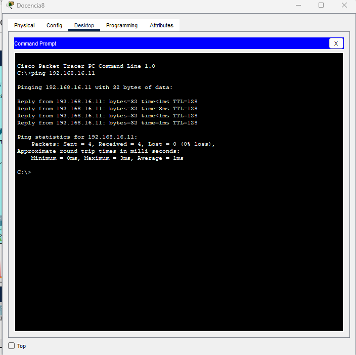

---

#### VLAN 36 — BIBLIOTECA 
**Desde:** Biblioteca1 (Ed. B) `192.168.16.10`  
**Hacia:** Biblioteca6 (Ed. C) `192.168.16.23`

```
ping 192.168.16.23
```

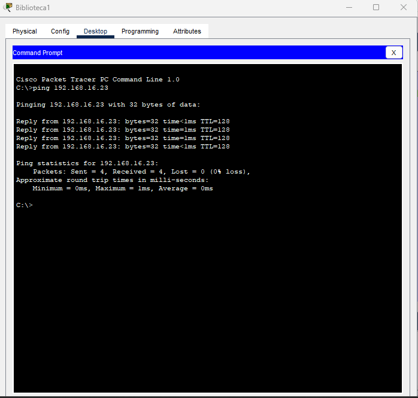

---

#### VLAN 46 — LABORATORIO 
**Desde:** Laboratorio2 (Ed. A) `192.168.16.3`  
**Hacia:** Laboratorio3 (Ed. D) `192.168.16.36`

```
ping 192.168.16.36
```

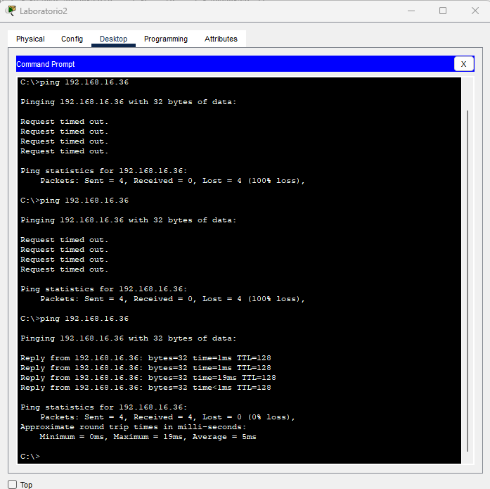

---

#### VLAN 56 — VISITANTE 
**Desde:** Visitantes1 (Ed. D) `192.168.16.30`  
**Hacia:** Visitantes2 (Ed. D) `192.168.16.31`

```
ping 192.168.16.31
```

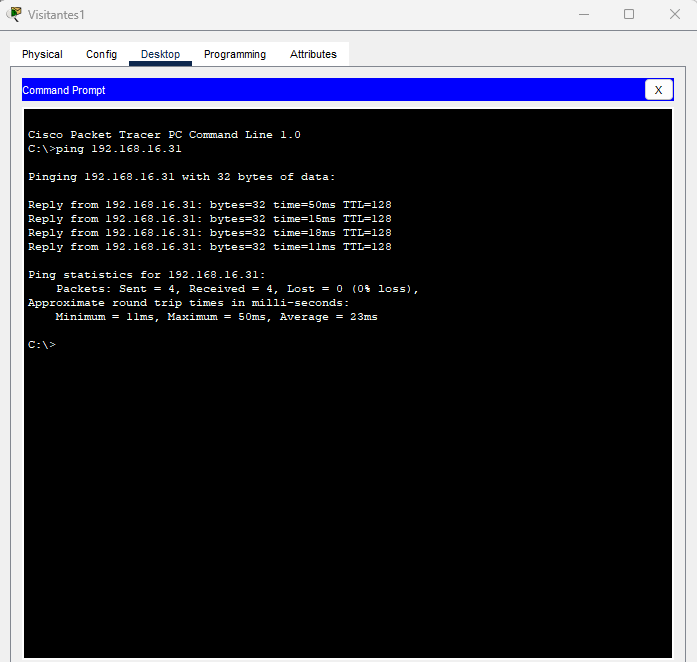

---

### Pings Fallidos (distinta VLAN)


#### VLAN 16 → VLAN 26 
**Desde:** Admin2 (VLAN 16) `192.168.16.1`  
**Hacia:** Docencia9 (VLAN 26) `192.168.16.22`

```
ping 192.168.16.22
```

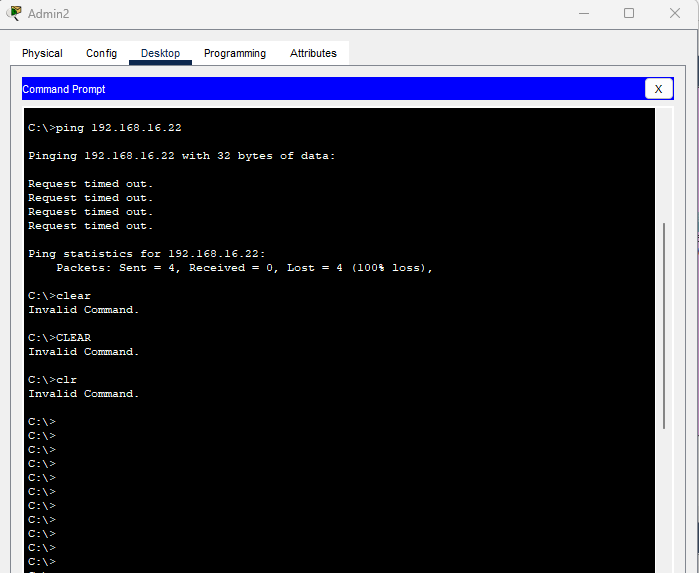

Resultado esperado:
```
Request timeout for icmp_seq 0
Request timeout for icmp_seq 1
```

---

#### VLAN 26 → VLAN 36 
**Desde:** Docencia6 (VLAN 26) `192.168.16.11`  
**Hacia:** Biblioteca1 (VLAN 36) `192.168.16.10`

```
ping 192.168.16.10
```

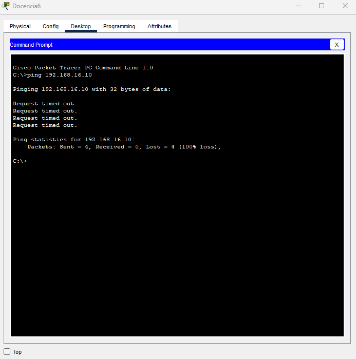

---

#### VLAN 36 → VLAN 46 
**Desde:** Biblioteca6 (VLAN 36) `192.168.16.23`  
**Hacia:** Laboratorio2 (VLAN 46) `192.168.16.3`

```
ping 192.168.16.3
```

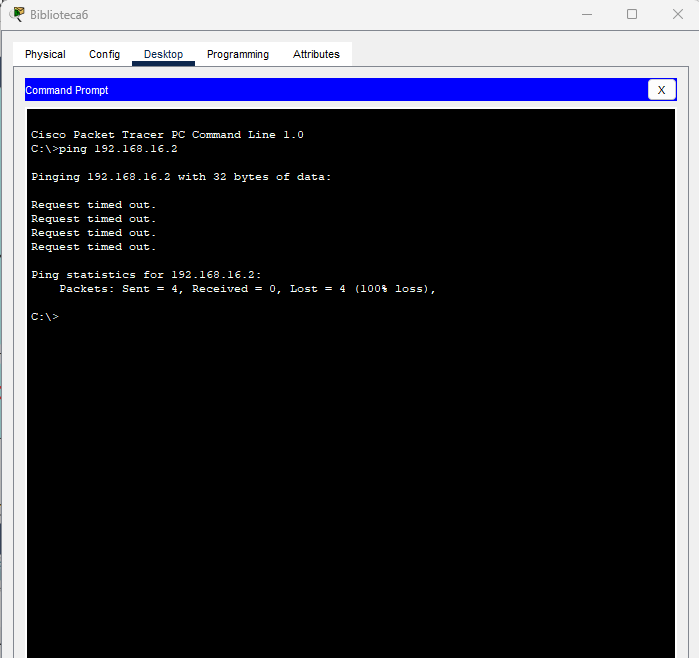

---

#### VLAN 46 → VLAN 56 
**Desde:** Laboratorio3 (VLAN 46) `192.168.16.36`  
**Hacia:** Visitantes1 (VLAN 56) `192.168.16.30`

```
ping 192.168.16.30
```

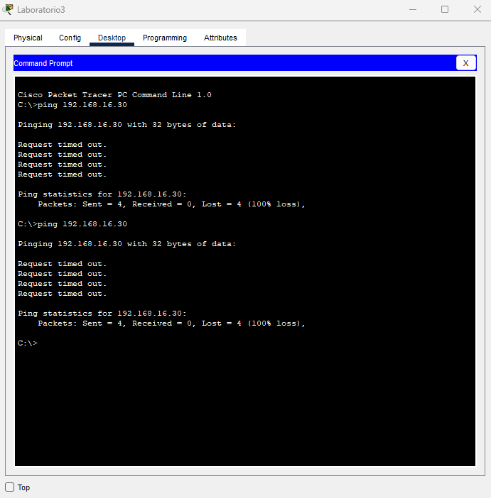

---

#### VLAN 56 → VLAN 16 
**Desde:** Visitantes2 (VLAN 56) `192.168.16.31`  
**Hacia:** Admin2 (VLAN 16) `192.168.16.1`

```
ping 192.168.16.1
```

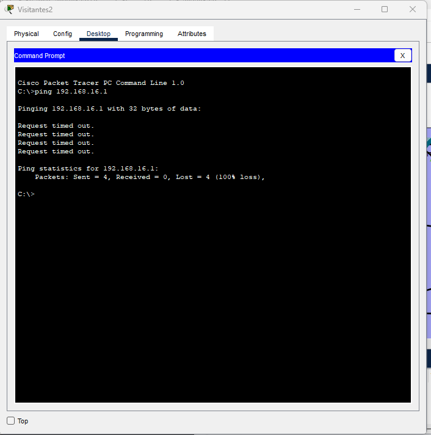

---

## 10. Capturas de Verificación


### show spanning-tree (SW-A1)

> **Comando:** En SW-A1 ejecuta `show spanning-tree`  
> **Qué debe mostrar:** SW-A1 como "This bridge is the root" en todas las VLANs 16, 26, 36, 46, 56 con prioridad 4096+VLAN_ID.

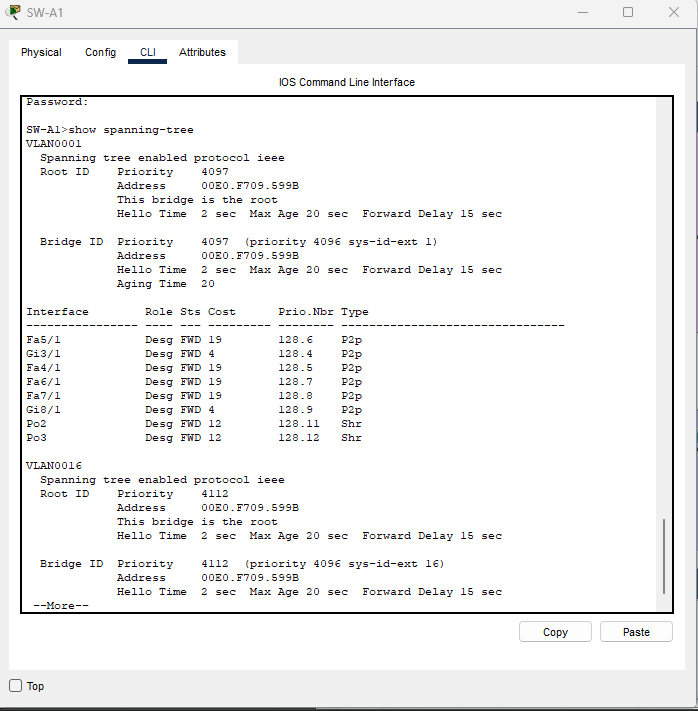

---

### show etherchannel summary (SW-A1)

> **Comando:** En SW-A1 ejecuta `show etherchannel summary`  
> **Qué debe mostrar:** Po2(SU) LACP con Fa6/1(P) Fa7/1(P) y Po3(SU) LACP con Fa4/1(P) Fa5/1(P)

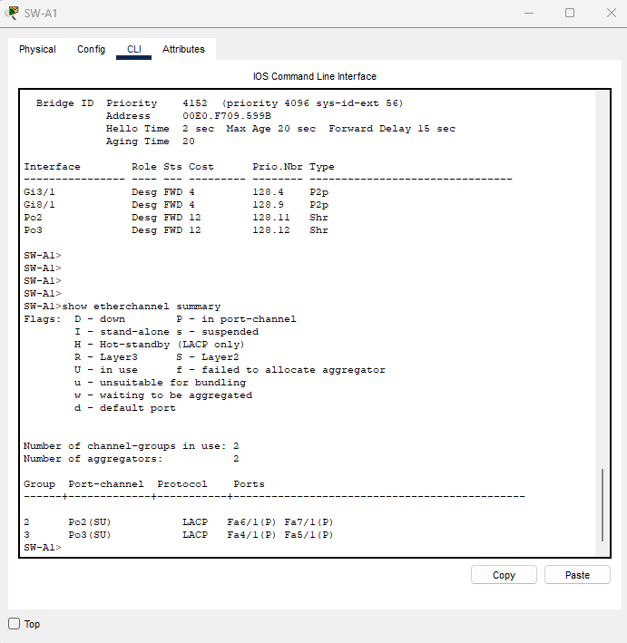

---

### show etherchannel summary (SW-A2)

> **Comando:** En SW-A2 ejecuta `show etherchannel summary`  
> **Qué debe mostrar:** Po1(SU) PAgP con Fa0/2(P) Fa0/3(P)

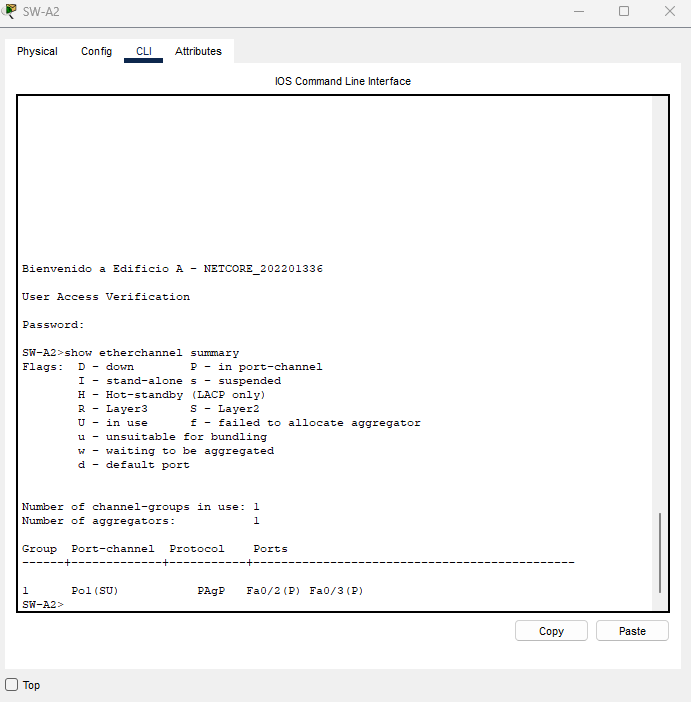

---

### show etherchannel summary (SW-B1)

> **Comando:** En SW-B1 ejecuta `show etherchannel summary`  
> **Qué debe mostrar:** Po1(SU) LACP con Fa7/1(P) Fa6/1(P) y Po2(SU) LACP con Fa4/1(P) Fa5/1(P)

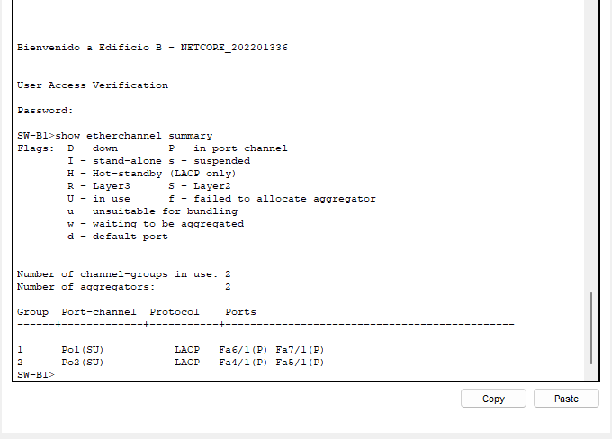

---

### show etherchannel summary (SW-B2)

> **Comando:** En SW-B2 ejecuta `show etherchannel summary`  
> **Qué debe mostrar:** Po1(SU) LACP con Fa5/1(P) Fa4/1(P) y Po2(SU) LACP con Fa9/1(P) Fa6/1(P)

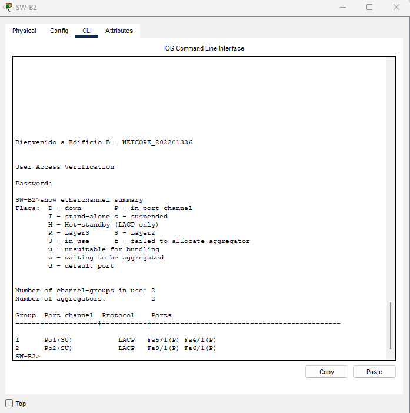

---

### show interfaces trunk (SW-A1)

> **Comando:** En SW-A1 ejecuta `show interfaces trunk`  
> **Qué debe mostrar:** Po2, Po3, Gig3/1, Gig8/1 todos en modo trunk con VLANs 16,26,36,46,56 activas.

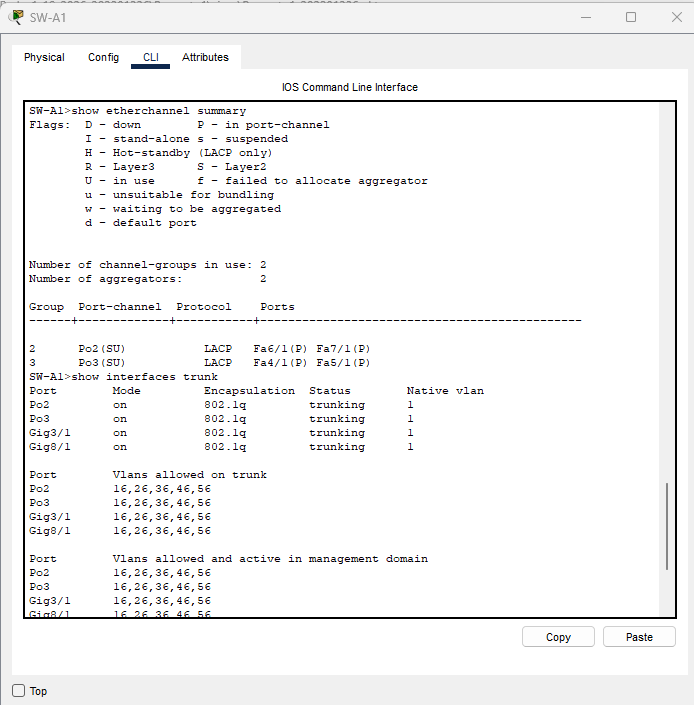

---

### show interfaces trunk (SW-B1)

> **Comando:** En SW-B1 ejecuta `show interfaces trunk`

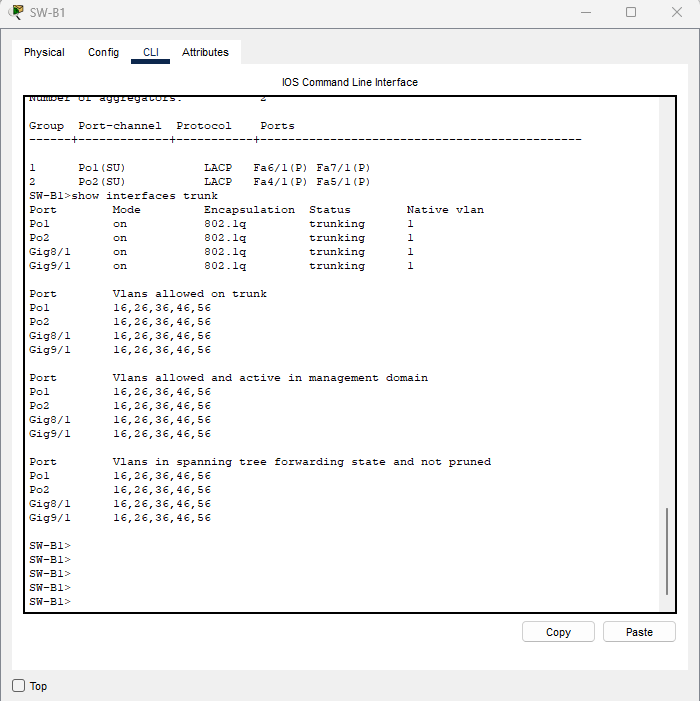

---

### show vtp status (SW-A1 — Server)

> **Comando:** En SW-A1 ejecuta `show vtp status`  
> **Qué debe mostrar:** VTP Operating Mode: Server, Domain: C3_NetCore, Version 2

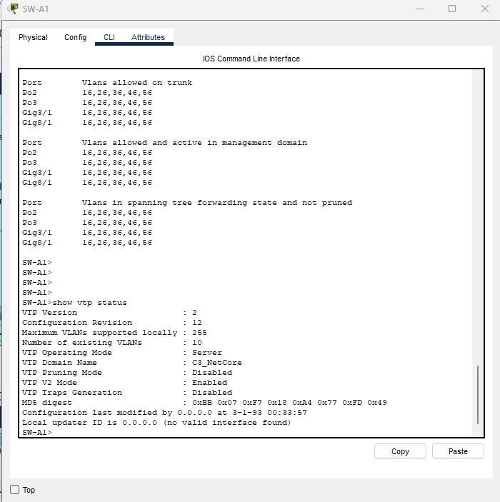

---

### show vtp status (SW-E1 — Transparente)

> **Comando:** En SW-E1 ejecuta `show vtp status`  
> **Qué debe mostrar:** VTP Operating Mode: Transparent, Domain: C3_NetCore

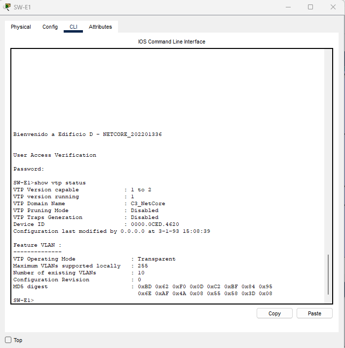

---

## 11. Presupuesto Estimado (Quetzales Guatemaltecos)

El siguiente presupuesto contempla los equipos necesarios para implementar físicamente la red del campus NetCore Academy. Se asume que todas las áreas están dentro de un mismo campus y los precios son estimados en el mercado guatemalteco/latinoamericano.

> **Tipo de cambio de referencia:** 1 USD = Q7.80

### Switches

| Cantidad | Equipo | Descripción | Precio Unitario (GTQ) | Total (GTQ) |
|---|---|---|---|---|
| 8 | Cisco Catalyst 2960-24TT | Switch 24 puertos FastEthernet + 2 GigabitEthernet uplink | Q2,730.00 | Q21,840.00 |
| 9 | Cisco Catalyst 2960-X (equiv. Switch-PT) | Switch con soporte para módulos FFE (fibra) | Q3,900.00 | Q35,100.00 |

### Módulos de Fibra Óptica

| Cantidad | Equipo | Descripción | Precio Unitario (GTQ) | Total (GTQ) |
|---|---|---|---|---|
| 36 | PT-SWITCH-NM-1FFE | Módulo de fibra óptica FastEthernet para Switch-PT (1 puerto FFE cada uno) | Q663.00 | Q23,868.00 |

> Se requieren aproximadamente 4 módulos por switch de distribución para cubrir todos los enlaces de fibra inter-edificios.

### Cables

| Cantidad | Equipo | Descripción | Precio Unitario (GTQ) | Total (GTQ) |
|---|---|---|---|---|
| 10 | Cable fibra óptica OM3 multimodo (50m) | Para interconexiones entre edificios 100Base-FX | Q351.00 | Q3,510.00 |
| 20 | Cable fibra óptica OM3 multimodo (10m) | Para conexiones cortas de fibra intra-edificio | Q195.00 | Q3,900.00 |
| 50 | Cable UTP Cat6 (patch cable 2m) | Para conexiones GigabitEthernet entre switches | Q62.40 | Q3,120.00 |
| 100 | Cable UTP Cat5e (patch cable 2m) | Para conexiones FastEthernet a dispositivos finales | Q39.00 | Q3,900.00 |
| 4 | Rollo Cable UTP Cat6 (305m) | Para cableado estructurado interno de edificios | Q936.00 | Q3,744.00 |
| 2 | Rollo Cable UTP Cat5e (305m) | Para cableado estructurado área de acceso | Q624.00 | Q1,248.00 |

### Conectores y Accesorios

| Cantidad | Equipo | Descripción | Precio Unitario (GTQ) | Total (GTQ) |
|---|---|---|---|---|
| 4 | Patch Panel 24 puertos Cat6 | Para organización del cableado estructurado | Q585.00 | Q2,340.00 |
| 4 | Rack de pared 12U | Para montaje de switches y patch panels | Q936.00 | Q3,744.00 |
| 200 | Conector RJ-45 Cat5e/6 | Para terminación de cables UTP | Q2.34 | Q468.00 |
| 20 | Par de conectores LC multimodo | Para terminación de cables de fibra óptica | Q93.60 | Q1,872.00 |
| 4 | Cable de consola USB-RJ45 | Para configuración de switches | Q117.00 | Q468.00 |

### Dispositivos de Acceso Inalámbrico

| Cantidad | Equipo | Descripción | Precio Unitario (GTQ) | Total (GTQ) |
|---|---|---|---|---|
| 2 | Cisco Aironet Access Point | Punto de acceso inalámbrico 802.11n (AC-A1, AC-D1) | Q1,950.00 | Q3,900.00 |

### Resumen del Presupuesto

| Categoría | Subtotal (GTQ) |
|---|---|
| Switches | Q56,940.00 |
| Módulos de fibra óptica | Q23,868.00 |
| Cables | Q19,422.00 |
| Conectores y accesorios | Q8,892.00 |
| Dispositivos inalámbricos | Q3,900.00 |
| **TOTAL ESTIMADO** | **Q113,022.00** |

> **Nota:** Los precios son estimados y pueden variar según proveedor y disponibilidad en el mercado local. No incluye mano de obra de instalación ni impuestos.

---

## Resumen de Configuración VTP

| Switch | Modo VTP | Dominio | Versión | Contraseña |
|---|---|---|---|---|
| SW-A1 | Server | C3_NetCore | 2 | proyecto12026 |
| SW-A2, SW-A3 | Client | C3_NetCore | 2 | proyecto12026 |
| SW-B1, SW-B2, SW-B3, SW-B4 | Client | C3_NetCore | 2 | proyecto12026 |
| SW-C1, SW-C2, SW-C3, SW-C4 | Client | C3_NetCore | 2 | proyecto12026 |
| SW-D1, SW-D2, SW-D3, SW-D4, SW-D5 | Client | C3_NetCore | 2 | proyecto12026 |
| SW-E1 | **Transparente** | C3_NetCore | 1 | proyecto12026 |

---

## Resumen de EtherChannels

| Port-Channel | Switch A | Puertos A | Switch B | Puertos B | Protocolo | Tipo |
|---|---|---|---|---|---|---|
| Po2 (SW-A1) / Po2 (SW-B1) | SW-A1 | Fa6/1, Fa7/1 | SW-B1 | Fa5/1, Fa4/1 | LACP | Inter-edificios |
| Po3 (SW-A1) / Po1 (SW-C4) | SW-A1 | Fa4/1, Fa5/1 | SW-C4 | Fa4/1, Fa5/1 | LACP | Inter-edificios |
| Po2 (SW-C4) / Po1 (SW-D1) | SW-C4 | Fa6/1, Fa9/1 | SW-D1 | Fa4/1, Fa6/1 | LACP | Inter-edificios |
| Po1 (SW-B1) / Po1 (SW-B2) | SW-B1 | Fa7/1, Fa6/1 | SW-B2 | Fa5/1, Fa4/1 | LACP | Inter-edificios |
| Po2 (SW-B2) / Po1 (SW-D5) | SW-B2 | Fa9/1, Fa6/1 | SW-D5 | Fa4/1, Fa5/1 | LACP | Inter-edificios |
| Po1 (SW-A2) / Po1 (SW-A3) | SW-A2 | Fa0/2, Fa0/3 | SW-A3 | Fa0/2, Fa0/3 | PAgP | Intra-edificio |

---

*Manual Técnico generado para el Proyecto 1 — NetCore Academy*  
*Redes de Computadoras 1 — FIUSAC — 2026*  
*Carnet: 202201336*
