# Manual Técnico — Proyecto 2: Parte Física
**Redes de Computadoras 1 — Universidad San Carlos de Guatemala**  
**Facultad de Ingeniería — Ingeniería en Ciencias y Sistemas**  
**Carnet:** 202201336  
**Fecha:** Mayo 2026

---

## Tabla de Contenidos

1. [Descripción General del Proyecto](#1-descripción-general-del-proyecto)
2. [Topología de Red Implementada](#2-topología-de-red-implementada)
3. [Tabla de Direccionamiento IP](#3-tabla-de-direccionamiento-ip)
4. [Configuración de Adaptadores de Red en VMware](#4-configuración-de-adaptadores-de-red-en-vmware)
5. [Configuración del Router Kali](#5-configuración-del-router-kali)
6. [Configuración de Linux Cliente (Mint)](#6-configuración-de-linux-cliente-mint)
7. [Configuración de la Computadora Física (Windows)](#7-configuración-de-la-computadora-física-windows)
8. [Reenvío de Paquetes IPv4 en Kali](#8-reenvío-de-paquetes-ipv4-en-kali)
9. [Pruebas de Conectividad](#9-pruebas-de-conectividad)
10. [Análisis de Tráfico con Wireshark](#10-análisis-de-tráfico-con-wireshark)
11. [Análisis de Protocolos](#11-análisis-de-protocolos)

---

## 1. Descripción General del Proyecto

Este proyecto implementa una red física simulada mediante virtualización, utilizando VMware como plataforma de virtualización. El objetivo es demostrar conectividad real entre redes diferentes mediante enrutamiento a nivel de Capa 3, sin depender de equipo físico de red.

La infraestructura está compuesta por tres elementos principales:

| Elemento | Sistema Operativo | Rol en la Red |
|---|---|---|
| Máquina Virtual 1 | Kali Linux | Router Linux (enrutador entre dos segmentos) |
| Máquina Virtual 2 | Linux Mint | Computadora cliente en red interna |
| Computadora Física | Windows | Host local, conectado vía VMware VMnet1 |

La arquitectura permite que la computadora física se comunique con la máquina virtual Linux Mint **únicamente a través del router Kali**, demostrando el funcionamiento básico de un dispositivo de Capa 3 del modelo OSI.

---

## 2. Topología de Red Implementada

### Diagrama lógico de la red

```
┌─────────────────────────────────────────────────────────────┐
│                   COMPUTADORA FÍSICA                        │
│                      Windows                                │
│              VMnet1: 192.168.186.1/24                       │
└──────────────────────┬──────────────────────────────────────┘
                       │ VMware Host-Only (VMnet1)
                       │ 192.168.186.0/24
                       │
┌──────────────────────┴──────────────────────────────────────┐
│                   ROUTER KALI                               │
│   eth0: 192.168.182.x/24  (NAT - Internet)                  │
│   eth1: 192.168.186.10/24 (Host-Only VMnet1 → Windows)      │
│   eth2: 192.168.106.1/24  (Segmento LAN → Mint)             │
│              ip_forward = 1                                 │
└──────────────────────┬──────────────────────────────────────┘
                       │ Segmento de LAN interno
                       │ 192.168.106.0/24
                       │
┌──────────────────────┴──────────────────────────────────────┐
│                 LINUX CLIENTE (Mint)                        │
│              ens37: 192.168.106.20/24                       │
│              Gateway: 192.168.106.1                         │
└─────────────────────────────────────────────────────────────┘
```

### Descripción del flujo de tráfico

Cuando la computadora física (Windows) envía tráfico hacia Linux Mint (`192.168.106.20`), el paquete sigue esta ruta:

1. Windows (`192.168.186.1`) → envía paquete hacia `192.168.106.20`
2. La ruta estática en Windows redirige el tráfico al gateway `192.168.186.10` (Kali)
3. Kali recibe el paquete en `eth1`, lo enruta por `eth2` hacia `192.168.106.20`
4. Mint recibe el paquete y responde por su gateway `192.168.106.1` (Kali)
5. Kali reenvía la respuesta de vuelta a Windows por `eth1`

---

## 3. Tabla de Direccionamiento IP

| Dispositivo | Interfaz | Tipo de Red | Dirección IP | Máscara | Gateway |
|---|---|---|---|---|---|
| Windows (Host físico) | VMnet1 | Host-Only | 192.168.186.1 | 255.255.255.0 | — |
| Kali (Router) | eth0 | NAT (Internet) | DHCP (192.168.182.x) | 255.255.255.0 | 192.168.182.2 |
| Kali (Router) | eth1 | Host-Only (VMnet1) | 192.168.186.10 | 255.255.255.0 | — |
| Kali (Router) | eth2 | Segmento LAN | 192.168.106.1 | 255.255.255.0 | — |
| Linux Mint (Cliente) | ens37 | Segmento LAN | 192.168.106.20 | 255.255.255.0 | 192.168.106.1 |

> **Nota:** La X del carnet es 6, por lo tanto las redes utilizadas son `192.168.186.0/24` para la red Host-Only y `192.168.106.0/24` para la red interna, siguiendo el patrón indicado en el enunciado (192.168.5X.0/24 y 192.168.10X.0/24).

---

## 4. Configuración de Adaptadores de Red en VMware

### Adaptadores de la Máquina Virtual Kali (Router)

| Adaptador | Tipo de Red en VMware | Interfaz en Kali | Propósito |
|---|---|---|---|
| Adaptador 1 | NAT | eth0 | Acceso a internet durante configuración |
| Adaptador 2 | Host-Only (VMnet1) | eth1 | Comunicación con la computadora física |
| Adaptador 3 | Segmento de LAN | eth2 | Comunicación con Linux Mint cliente |

### Adaptadores de la Máquina Virtual Linux Mint (Cliente)

| Adaptador | Tipo de Red en VMware | Interfaz en Mint | Propósito |
|---|---|---|---|
| Adaptador 1 | Segmento de LAN (mismo nombre que Kali eth2) | ens37 | Comunicación con el router Kali |

> **Importante:** El nombre del Segmento de LAN debe ser **idéntico** en ambas VMs para que puedan comunicarse entre sí.

### Captura — Configuración de adaptadores en VMware


**Kali — Adaptador 2 (Host-Only VMnet1):**

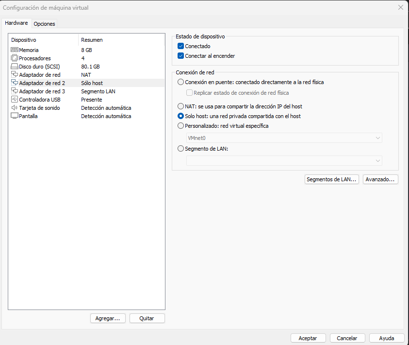

**Kali — Adaptador 3 (Segmento de LAN):**

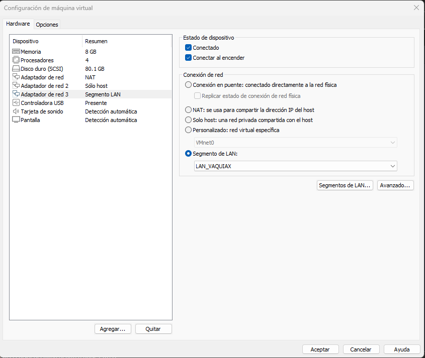

**Mint — Adaptador 1 (Segmento de LAN):**

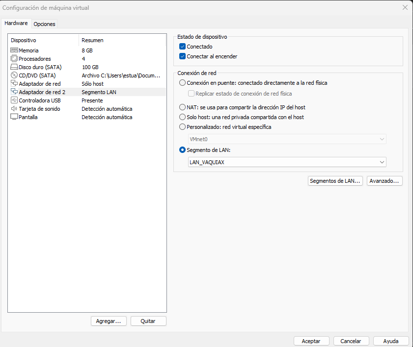

---

## 5. Configuración del Router Kali

### 5.1 Verificación de interfaces disponibles

Antes de configurar, se verifica qué interfaces están disponibles en el sistema:

```bash
ip a
```

El sistema debe mostrar al menos tres interfaces: `eth0` (NAT), `eth1` (Host-Only) y `eth2` (Segmento LAN).

### 5.2 Comandos de configuración aplicados

```bash
# Limpiar IPs dinámicas de eth1 (Host-Only)
sudo ip addr flush dev eth1

# Asignar IP estática en eth1 (red Host-Only hacia Windows)
sudo ip addr add 192.168.186.10/24 dev eth1
sudo ip link set eth1 up

# Asignar IP estática en eth2 (red interna hacia Mint)
sudo ip addr add 192.168.106.1/24 dev eth2
sudo ip link set eth2 up

# Habilitar reenvío de paquetes IPv4
sudo sysctl -w net.ipv4.ip_forward=1
```

### 5.3 Verificación de la configuración

```bash
# Verificar interfaces y direcciones IP
ip a

# Verificar tabla de rutas
ip route
```

### 5.4 Resultado esperado — ip a

La salida del comando `ip a` debe mostrar:

- `eth0` con IP dinámica de NAT (`192.168.182.x`)
- `eth1` con IP estática `192.168.186.10/24`
- `eth2` con IP estática `192.168.106.1/24`

### Captura — Configuración aplicada en Kali (ip a)


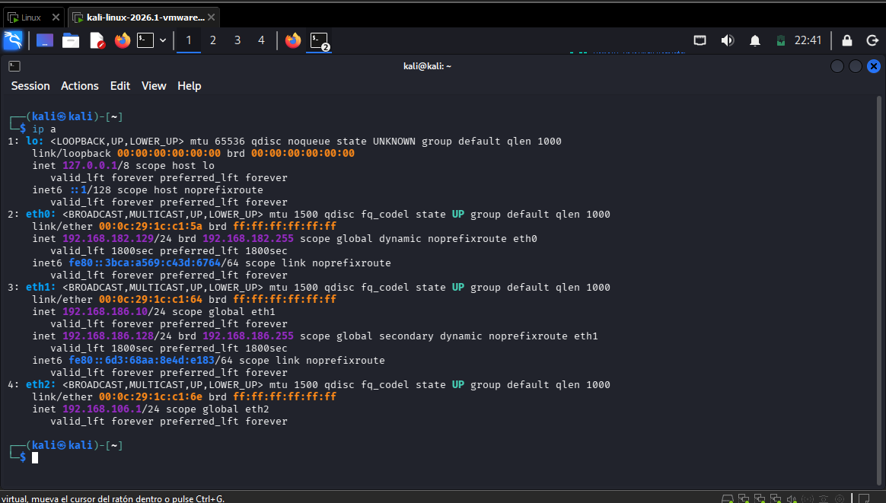

### Captura — Tabla de rutas en Kali (ip route)


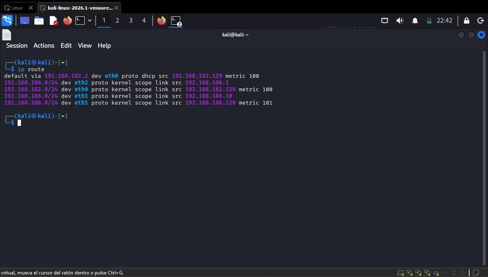

---

## 6. Configuración de Linux Cliente (Mint)

### 6.1 Verificación de interfaces disponibles

```bash
ip a
```

Se identifican las interfaces disponibles. En este caso la interfaz conectada al Segmento de LAN es `ens37`.

### 6.2 Comandos de configuración aplicados

```bash
# Asignar IP estática en ens37 (red interna)
sudo ip addr add 192.168.106.20/24 dev ens37
sudo ip link set ens37 up

# Agregar ruta por defecto hacia el router Kali
sudo ip route add default via 192.168.106.1 dev ens37

# Verificar configuración
ip a
ip route
```

### 6.3 Resultado esperado

- `ens37` debe tener la IP `192.168.106.20/24`
- La ruta por defecto debe apuntar a `192.168.106.1` (router Kali)

### Captura — Configuración aplicada en Linux Mint (ip a)


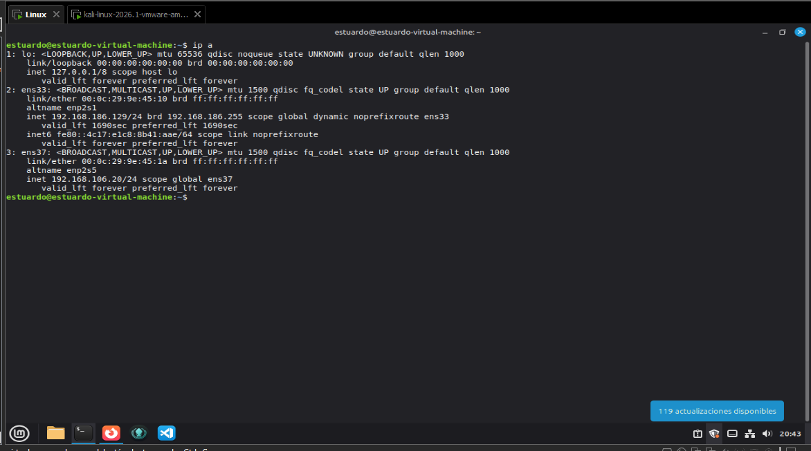

### Captura — Tabla de rutas en Linux Mint (ip route)

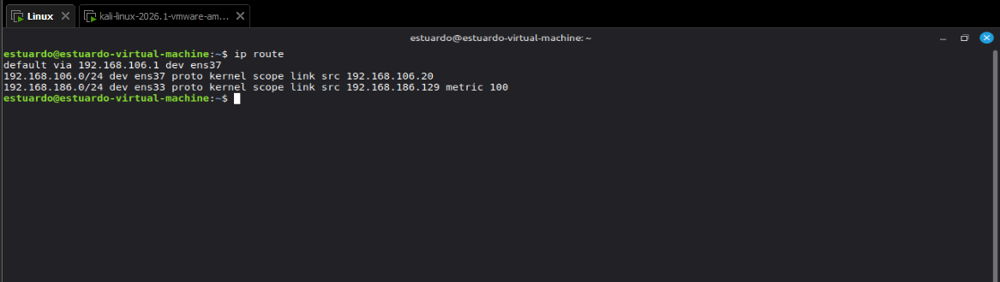

---

## 7. Configuración de la Computadora Física (Windows)

### 7.1 Verificación del adaptador VMnet1

La computadora física se comunica con Kali a través del adaptador virtual **VMware Network Adapter VMnet1**, que tiene la IP `192.168.186.1` asignada automáticamente por VMware.

```powershell
# Verificar adaptadores de red
ipconfig /all
```

### 7.2 Agregar ruta estática hacia la red de Mint

Para que Windows pueda alcanzar la red interna (`192.168.106.0/24`) donde se encuentra Mint, se debe agregar una ruta estática que indique que el siguiente salto es el router Kali (`192.168.186.10`).

```powershell
# Agregar ruta estática (temporal)
route add 192.168.106.0 mask 255.255.255.0 192.168.186.10

# Agregar ruta estática (permanente, sobrevive reinicios)
route -p add 192.168.106.0 mask 255.255.255.0 192.168.186.10
```

### 7.3 Permitir ICMP en el firewall de Windows

Para que las pruebas de ping desde Mint hacia Windows funcionen correctamente, se debe permitir el tráfico ICMP entrante:

```powershell
netsh advfirewall firewall add rule name="Permitir ICMPv4 VirtualBox" protocol=icmpv4:8,any dir=in action=allow
```

### 7.4 Verificar rutas configuradas

```powershell
route print
```

### Captura — ipconfig /all en Windows


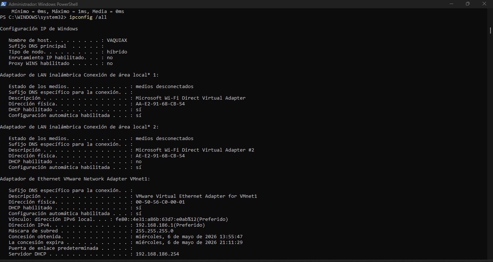

### Captura — route print en Windows


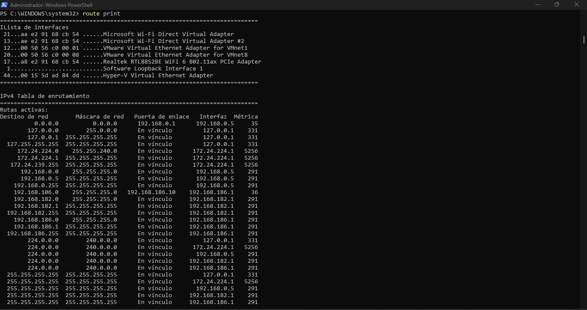

---

## 8. Reenvío de Paquetes IPv4 en Kali

El reenvío de paquetes IPv4 (IP forwarding) es la capacidad de un dispositivo Linux de recibir paquetes en una interfaz y reenviarlos por otra interfaz diferente. Sin esta función habilitada, Kali actuaría como un host común y descartaría cualquier paquete destinado a una red diferente.

### 8.1 Comando para habilitar

```bash
sudo sysctl -w net.ipv4.ip_forward=1
```

### 8.2 Verificar que está activo

```bash
cat /proc/sys/net/ipv4/ip_forward
```

El resultado debe ser `1`. Si muestra `0`, el reenvío está desactivado.

### 8.3 Para hacerlo permanente (persiste al reiniciar)

```bash
echo "net.ipv4.ip_forward=1" | sudo tee -a /etc/sysctl.conf
sudo sysctl -p
```

### Captura — Verificación de ip_forward activo en Kali


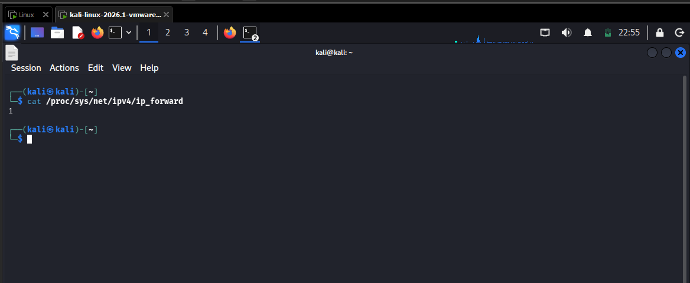

---

## 9. Pruebas de Conectividad

### 9.1 Ping desde Windows hacia Kali (eth1)

Verifica la comunicación directa entre la computadora física y el router.

```powershell
ping 192.168.186.10
```

**Resultado esperado:** 4 respuestas con 0% de pérdida de paquetes.

### Captura — Ping desde Windows hacia Kali


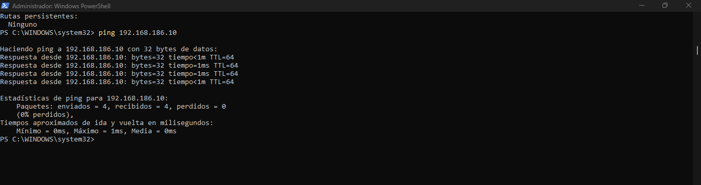

---

### 9.2 Ping desde Windows hacia Linux Mint (a través de Kali)

Verifica la comunicación completa de extremo a extremo, pasando por el router.

```powershell
ping 192.168.106.20
```

**Resultado esperado:** 4 respuestas con 0% de pérdida de paquetes.

### Captura — Ping desde Windows hacia Mint


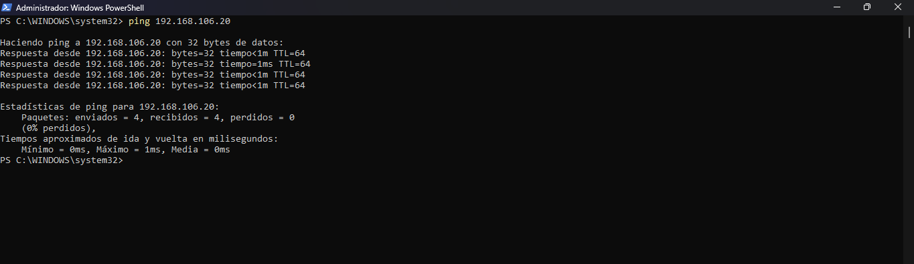

---

### 9.3 Tracert desde Windows hacia Linux Mint

Este comando es la prueba más importante del proyecto. Evidencia que el tráfico pasa primero por el router Kali antes de llegar a Mint.

```powershell
tracert 192.168.106.20
```

**Resultado esperado:**
```
Traza a 192.168.106.20 sobre caminos de 30 saltos como máximo.
  1    <1 ms    <1 ms    <1 ms  192.168.186.10   ← Router Kali
  2    <1 ms    <1 ms    <1 ms  192.168.106.20   ← Linux Mint
Traza completa.
```

### Captura — Tracert desde Windows hacia Mint


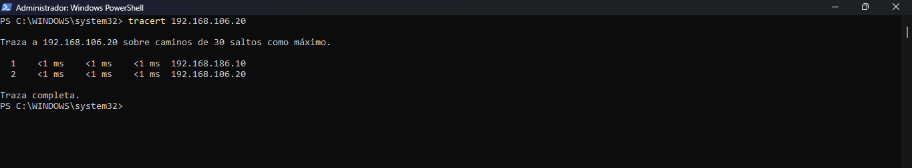

---

### 9.4 Ping desde Kali hacia Windows

```bash
ping 192.168.186.1
```

**Resultado esperado:** Respuestas con TTL=128 (Windows) y 0% de pérdida.

### Captura — Ping desde Kali hacia Windows


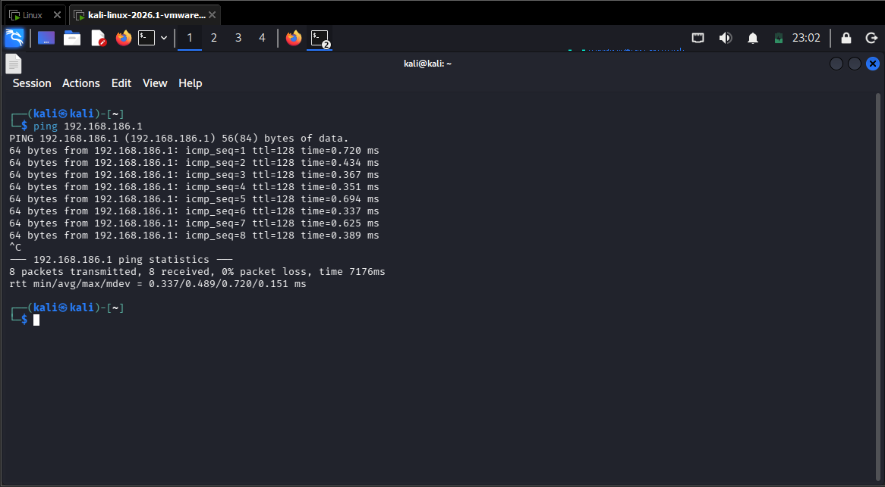

---

### 9.5 Ping desde Kali hacia Linux Mint

```bash
ping 192.168.106.20
```

**Resultado esperado:** Respuestas con TTL=64 (Linux) y 0% de pérdida.

### Captura — Ping desde Kali hacia Mint


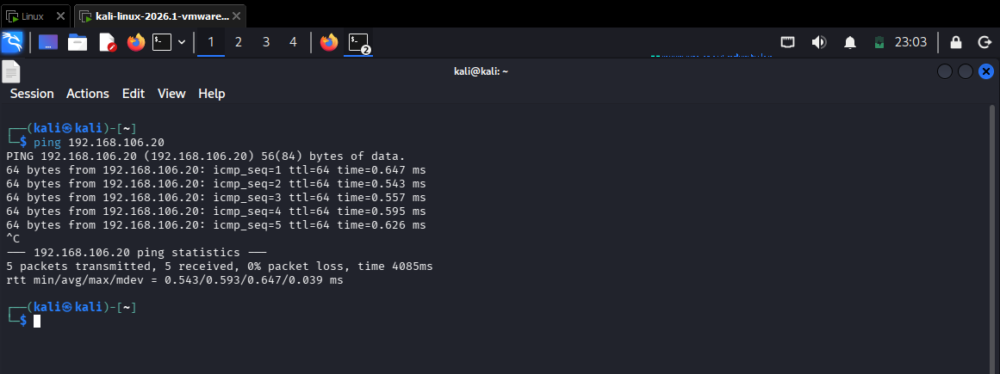

---

### 9.6 Ping desde Linux Mint hacia Kali

```bash
ping 192.168.106.1
```

**Resultado esperado:** Respuestas con TTL=64 y 0% de pérdida.

### Captura — Ping desde Mint hacia Kali


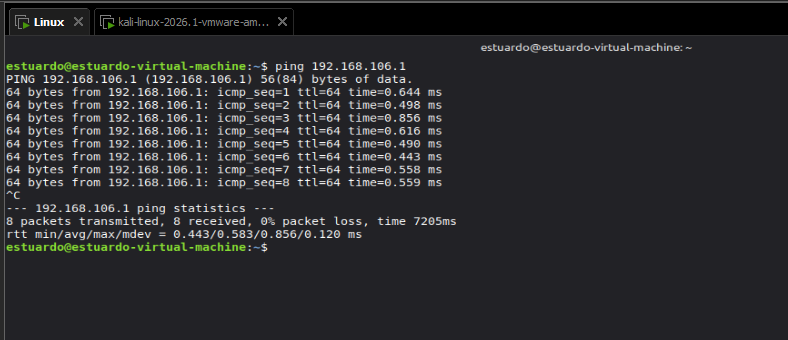

---

### 9.7 Ping desde Linux Mint hacia Windows (a través de Kali)

```bash
ping 192.168.186.1
```

**Resultado esperado:** Respuestas con TTL=128 y 0% de pérdida.

### Captura — Ping desde Mint hacia Windows


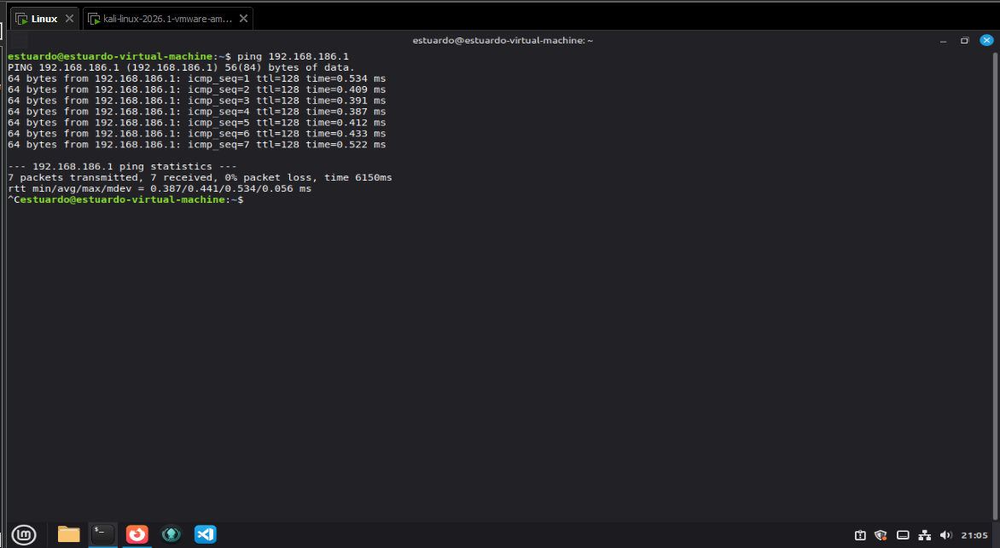

---

### Resumen de pruebas de conectividad

| Origen | Destino | IP Destino | Resultado |
|---|---|---|---|
| Windows | Kali (eth1) | 192.168.186.10 | ✅ Exitoso |
| Windows | Linux Mint | 192.168.106.20 | ✅ Exitoso (vía Kali) |
| Kali | Windows | 192.168.186.1 | ✅ Exitoso |
| Kali | Linux Mint | 192.168.106.20 | ✅ Exitoso |
| Linux Mint | Kali | 192.168.106.1 | ✅ Exitoso |
| Linux Mint | Windows | 192.168.186.1 | ✅ Exitoso (vía Kali) |

---

## 10. Análisis de Tráfico con Wireshark

El análisis de tráfico se realizó capturando paquetes en el adaptador **VMware Network Adapter VMnet1** desde la computadora física con Windows, y adicionalmente desde Kali usando `tcpdump` para capturar tráfico ARP.

### 10.1 Captura de tráfico ICMP (ping)

**Interfaz de captura:** VMware Network Adapter VMnet1 (en Windows)  
**Filtro aplicado:** `icmp`  
**Acción realizada durante la captura:**

```powershell
ping 192.168.106.20
```

**Qué se observa:**
- Paquetes **Echo (ping) request** desde `192.168.186.1` hacia `192.168.106.20`
- Paquetes **Echo (ping) reply** desde `192.168.106.20` hacia `192.168.186.1`
- El router Kali (`192.168.186.10`) aparece como intermediario en las direcciones MAC

### Captura — Wireshark filtro ICMP


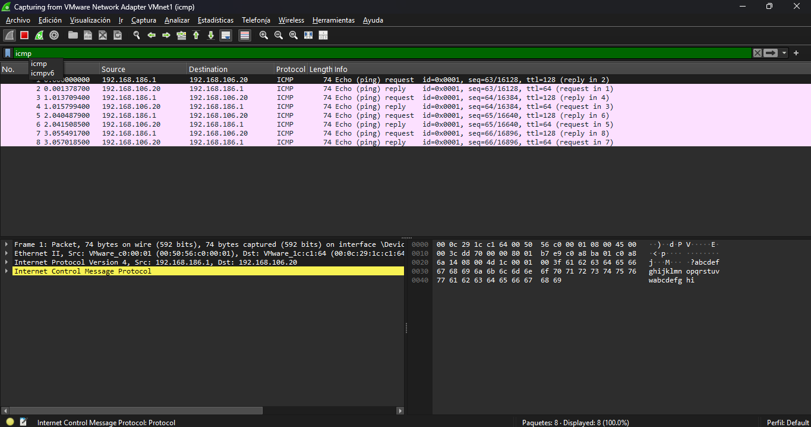

---

### 10.2 Captura de tráfico ARP

El tráfico ARP fue capturado desde **Kali** usando `tcpdump`, ya que VMware maneja el ARP internamente entre el host Windows y las VMs, impidiendo su captura directa en Wireshark desde Windows.

**Comando ejecutado en Kali:**

```bash
sudo tcpdump -i eth1 arp -v
```

**Acción realizada durante la captura (en Windows):**

```powershell
arp -d *
ping 192.168.186.10
```

**Qué se observa:**
- Petición ARP: `Who has 192.168.186.10? Tell 192.168.186.1`
- Respuesta ARP: `192.168.186.10 is at XX:XX:XX:XX:XX:XX` (MAC de Kali eth1)

### Captura — tcpdump ARP en Kali


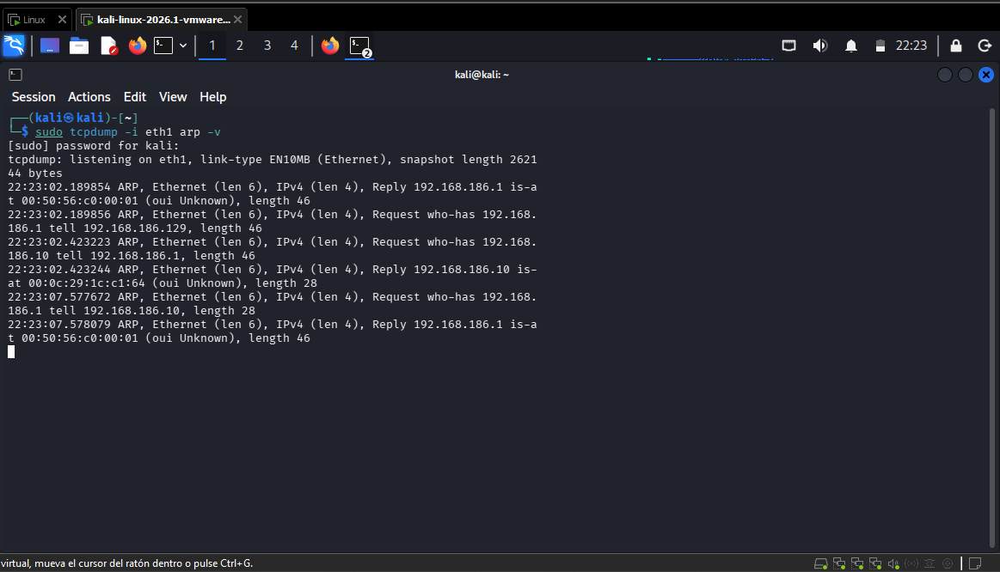

---

### 10.3 Captura de tráfico entre Windows y Linux Mint

**Interfaz de captura:** VMware Network Adapter VMnet1 (en Windows)  
**Filtro aplicado:**
```
ip.addr == 192.168.186.1 && ip.addr == 192.168.106.20
```

**Acción realizada durante la captura:**

```powershell
ping 192.168.106.20
```

**Qué se observa:**
- Paquetes ICMP viajando entre Windows (`192.168.186.1`) y Mint (`192.168.106.20`)
- El router Kali aparece como intermediario a nivel de dirección MAC (no IP)

### Captura — Wireshark tráfico Windows a Mint


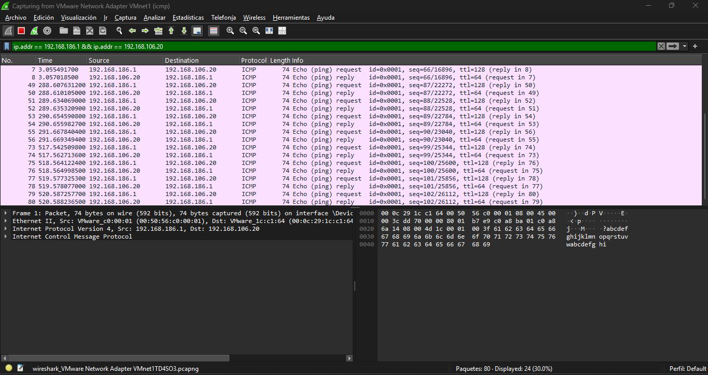

---

### 10.4 Captura de tráfico del router Kali

**Interfaz de captura:** VMware Network Adapter VMnet1 (en Windows)  
**Filtro aplicado:**
```
ip.addr == 192.168.186.10
```

**Acción realizada durante la captura:**

```powershell
ping 192.168.186.10
```

**Qué se observa:**
- Paquetes ICMP con origen y destino en `192.168.186.10` (Kali)
- Se puede observar la dirección MAC de la interfaz eth1 de Kali

### Captura — Wireshark tráfico del router Kali


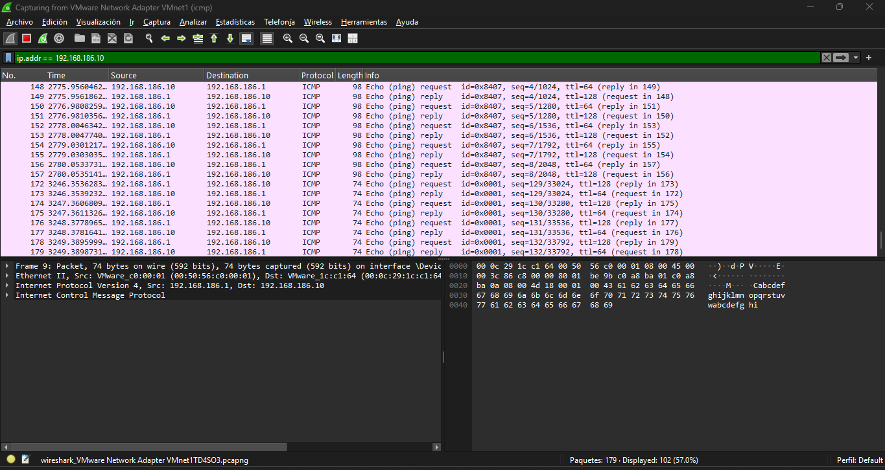

---

### Resumen de capturas Wireshark

| # | Herramienta | Filtro / Comando | Capturado en | Propósito |
|---|---|---|---|---|
| 1 | Wireshark | `icmp` | Windows VMnet1 | Ver paquetes ping request y reply |
| 2 | tcpdump | `arp -v` en eth1 | Kali | Ver resolución ARP entre Windows y Kali |
| 3 | Wireshark | `ip.addr == 192.168.186.1 && ip.addr == 192.168.106.20` | Windows VMnet1 | Ver tráfico completo Windows ↔ Mint |
| 4 | Wireshark | `ip.addr == 192.168.186.10` | Windows VMnet1 | Ver tráfico del router Kali |

---

## 11. Análisis de Protocolos

### 11.1 ¿Qué protocolo utiliza el comando ping?

El comando `ping` utiliza el protocolo **ICMP** (Internet Control Message Protocol — Protocolo de Mensajes de Control de Internet), definido en el RFC 792. ICMP opera en la **Capa 3 (Red)** del modelo OSI.

Cuando se ejecuta `ping 192.168.106.20`, se envían paquetes de tipo **Echo Request (Tipo 8)** y se esperan respuestas de tipo **Echo Reply (Tipo 0)**. Cada paquete contiene un número de secuencia y un TTL que permiten medir latencia y detectar pérdida de paquetes.

### 11.2 ¿Para qué se utiliza ARP?

**ARP** (Address Resolution Protocol — Protocolo de Resolución de Direcciones) opera en la **Capa 2 (Enlace de Datos)** del modelo OSI y sirve para **resolver direcciones IP en direcciones MAC** dentro de una misma red local.

Cuando un dispositivo quiere comunicarse con otro en la misma red, necesita conocer su dirección MAC para construir la trama Ethernet. ARP funciona así:

1. El dispositivo origen envía un broadcast: `"¿Quién tiene la IP X.X.X.X? Dígaselo a Y.Y.Y.Y"`
2. El dispositivo con esa IP responde con su dirección MAC
3. El origen almacena esta información en su **caché ARP** para futuras comunicaciones

### 11.3 ¿Qué dirección MAC se usa como destino cuando el tráfico va hacia otra red?

Cuando el tráfico va **hacia otra red** (como de Windows en `192.168.186.0/24` hacia Mint en `192.168.106.0/24`), la dirección MAC de destino en la trama Ethernet **NO es la MAC de Mint**, sino la **MAC del router Kali** (específicamente la de su interfaz `eth1` con IP `192.168.186.10`).

Esto ocurre porque ARP solo puede resolver MACs dentro de la misma red local. Para llegar a una red diferente, el dispositivo origen usa ARP para encontrar la MAC de su **gateway (puerta de enlace)**, que en este caso es Kali. El router entonces se encarga de reenviar el paquete hacia la red de destino, cambiando las direcciones MAC en cada salto pero manteniendo las IPs originales.

| Campo | Valor en la trama que sale de Windows |
|---|---|
| IP origen | 192.168.186.1 (Windows) |
| IP destino | 192.168.106.20 (Mint) |
| MAC origen | MAC de VMnet1 de Windows |
| MAC destino | MAC de eth1 de Kali (el gateway) |

### 11.4 ¿Qué ocurre con el TTL cuando el paquete pasa por el router?

El **TTL** (Time To Live — Tiempo de Vida) es un campo en el encabezado IP que indica cuántos saltos puede dar un paquete antes de ser descartado. Su propósito es evitar que los paquetes circulen indefinidamente en la red.

**Cada vez que un paquete pasa por un router, el TTL se reduce en 1.** Si el TTL llega a 0, el router descarta el paquete y envía un mensaje ICMP de error `Time Exceeded` al origen.

En esta práctica se puede observar este comportamiento:

| Trayecto | TTL inicial | TTL al llegar |
|---|---|---|
| Windows → Kali (directo, 1 salto) | 128 (Windows) | 64 (Linux Kali) |
| Windows → Mint (2 saltos, vía Kali) | 128 | 63 (reducido 1 por Kali) |
| Mint → Windows (2 saltos, vía Kali) | 64 (Linux Mint) | 127 (reducido 1 por Kali) |

El comando `tracert` evidencia claramente los saltos: cada línea numerada representa un router que redujo el TTL en 1 al reenviar el paquete.

