# Manual Técnico — Proyecto 2: BanTech GT
**Redes de Computadoras 2 — Universidad San Carlos de Guatemala**  
**Carnet:** 202201336  
**Fecha:** Abril 2026

---

## Tabla de Contenidos

1. [Topología General](#1-topología-general)
2. [Topología por Sede](#2-topología-por-sede)
3. [Interfaces y Medios de Transmisión](#3-interfaces-y-medios-de-transmisión)
4. [Tabla de VLANs](#4-tabla-de-vlans)
5. [Dominios de Colisión por Área](#5-dominios-de-colisión-por-área)
6. [Dominios de Broadcast](#6-dominios-de-broadcast)
7. [Tabla de Direccionamiento IP](#7-tabla-de-direccionamiento-ip)
8. [Comandos por Dispositivo](#8-comandos-por-dispositivo)
9. [Pruebas de Ping](#9-pruebas-de-ping)
10. [Capturas de Verificación](#10-capturas-de-verificación)
11. [Presupuesto Estimado](#11-presupuesto-estimado)

---

## 1. Topología General

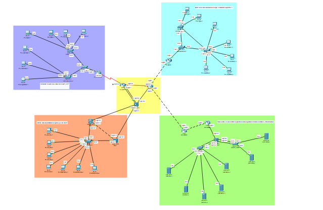

La red de BanTech GT se divide en cuatro sedes funcionales y un backbone nacional. El núcleo utiliza protocolos dinámicos y enlaces redundantes para garantizar convergencia, mientras que cada sede implementa la tecnología requerida por el enunciado:

- **Occidente:** Router-on-a-Stick con **EIGRP** y **VTP**.
- **Norte:** Red con redundancia de capa 2 mediante **Rapid PVST+**.
- **Oriente:** Alta disponibilidad de gateway con **HSRP**.
- **Data Center y Sede Central:** Segmento de alta seguridad con **rutas estáticas** y **EtherChannel**.

### Justificación de arquitectura

La arquitectura se diseñó para separar claramente las funciones de transporte, distribución y acceso. El backbone concentra el ruteo entre dominios distintos, mientras que las sedes implementan la tecnología específica que resuelve su necesidad operativa. Esta separación reduce el impacto de fallos, facilita la administración y permite demostrar convergencia, redundancia y segmentación, que son los objetivos principales del proyecto.

---

## 2. Topología por Sede

### Backbone Core

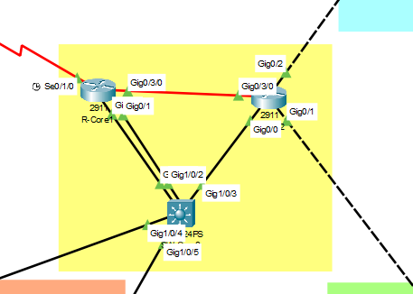

**Dispositivos:**
- **R-Core1** (Router 2911) — Núcleo principal y redistribución
- **R-Core2** (Router 2911) — Núcleo principal y redistribución

- **SW-Core3** (Switch multicapa 3650-24PS) — Nodo de alta conectividad para enlaces múltiples del backbone

**Rol técnico:**
- **OSPF** como protocolo principal del backbone.
- **Redistribución** entre OSPF, EIGRP, RIP y rutas estáticas.
- Enlace de **fibra óptica**, enlaces **Ethernet** y un enlace **serial** para cumplir el enunciado.
- **EtherChannel** para agrupar enlaces críticos donde aplica el diseño.

### Sede Occidente

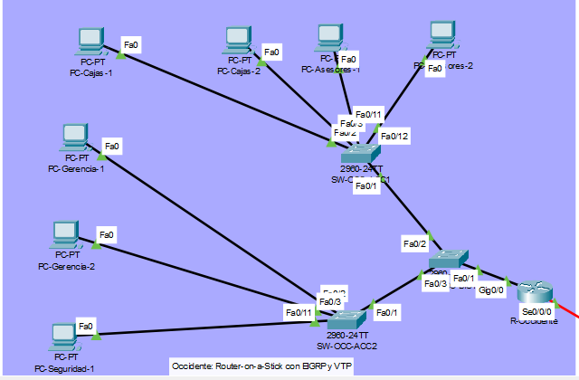

**Dispositivos:**
- **R-Occidente** (Router 2911)
- **SW-OCC-DIST** (Switch 2960-24TT)
- **SW-OCC-ACC1** (Switch 2960-24TT)
- **SW-OCC-ACC2** (Switch 2960-24TT)
- PCs de Cajas, Asesores, Gerencia y Seguridad

**Rol técnico:**
- **Router-on-a-Stick** en R-Occidente.
- **VTP Server** en el switch de distribución.
- **VTP Client** en los switches de acceso.
- Segmentación lógica por VLAN según áreas funcionales.

### Sede Norte

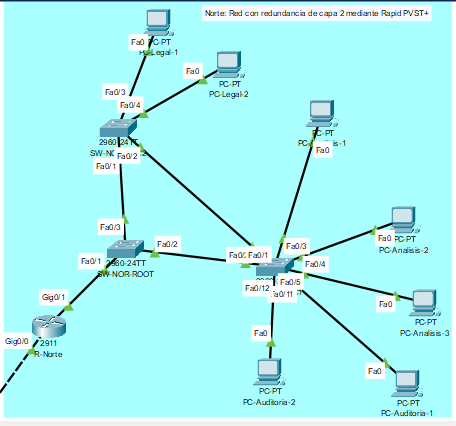

**Dispositivos:**
- **R-Norte** (Router 2911)
- **SW-NOR-ROOT** (Switch 2960-24TT)
- **SW-NOR-ACC1** (Switch 2960-24TT)
- **SW-NOR-ACC2** (Switch 2960-24TT)
- PCs de Análisis, Auditoría y Legal

**Rol técnico:**
- Diseño con **triángulo físico** para crear caminos alternos.
- **Rapid PVST+** para evitar loops y permitir convergencia rápida.
- **Root Bridge** forzado en SW-NOR-ROOT.

### Sede Oriente

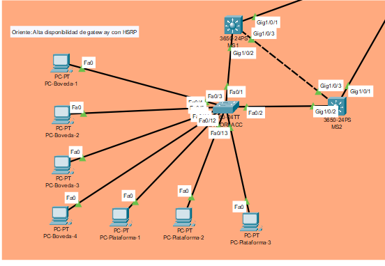

**Dispositivos:**
- **MS1** (Switch multicapa 3650-24PS)
- **MS2** (Switch multicapa 3650-24PS)
- **SW-ORI-ACC** (Switch 2960-24TT)
- PCs de Bóveda y Plataforma

**Rol técnico:**
- **HSRP** para proporcionar gateway virtual redundante.
- Enlace entre MS1 y MS2 para respaldo y control.
- Troncales hacia el switch de acceso para transportar VLANs de la sede.

### Data Center y Sede Central

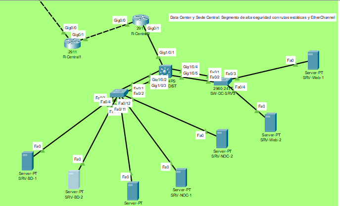

**Dispositivos:**
- **R-Central1** (Router 2911)
- **R-Central2** (Router 2911)
- **SW-DC-DIST** (Switch 3650-24PS)
- **SW-DC-SRV1** (Switch 2960-24TT)
- **SW-DC-SRV2** (Switch 2960-24TT)
- Servidores de BD, Web_Apps y NOC

**Rol técnico:**
- Segmento de **rutas estáticas**.
- **EtherChannel** en la capa de acceso para tráfico de servidores.
- Redistribución de rutas hacia el backbone a través de R-Central1.

### Justificación de la topología por sede

Occidente usa Router-on-a-Stick porque permite centralizar el ruteo inter-VLAN en un solo router y simplificar la administración del VTP en una agencia con varias áreas. Norte usa una topología en triángulo porque necesita redundancia física y reconvergencia rápida ante fallos. Oriente implementa dos switches multicapa porque la continuidad del gateway es crítica y un único dispositivo sería un punto único de falla. El Data Center usa EtherChannel y rutas estáticas porque prioriza disponibilidad, ancho de banda y control sobre el acceso a servidores sensibles.

---

## 3. Interfaces y Medios de Transmisión

### Jerarquía de medios

| Nivel | Segmento | Medio | Interfaz | Justificación |
|---|---|---|---|---|
| Núcleo nacional | Entre equipos del backbone | Fibra óptica, Ethernet y Serial | GigabitEthernet / Serial | Cumple la diversidad de medios solicitada y permite redundancia |
| Sedes | Router a switch de distribución | Cobre UTP Cat6 | GigabitEthernet | Soporta tráfico de VLANs y troncales 802.1Q |
| Acceso | PCs y servidores a switches | Cobre UTP Cat5e | FastEthernet | Suficiente para dispositivos finales |
| Alta disponibilidad | Enlaces críticos de acceso | Cobre UTP Cat6 | FastEthernet / GigabitEthernet | Permite EtherChannel y enlaces de respaldo |

### Tabla de conexiones del backbone

| Enlace | Medio | Puerto origen | Puerto destino | Protocolo |
|---|---|---|---|---|
| R-Core1 ↔ R-Core2 | Fibra óptica | Gig0/3/0 | Gig0/3/0 | Backbone principal |
| R-Core1 ↔ SW-Core3 | Cobre UTP Cat6 | Gig0/0 | Gig1/0/1 | EtherChannel / trunk lógico según diseño |
| R-Core1 ↔ SW-Core3 | Cobre UTP Cat6 | Gig0/1 | Gig1/0/2 | EtherChannel / trunk lógico según diseño |
| R-Core1 ↔ R-Occidente | Serial | Serial0/1/0 | Serial0/1/0 | WAN / EIGRP |
| R-Core2 ↔ SW-Core3 | Cobre UTP Cat6 | Gig0/0 | Gig1/0/3 | Backbone Ethernet |
| R-Core2 ↔ R-Central1 | Cobre UTP Cat6 | Gig0/1 | Gig0/0 | Transporte hacia Data Center |
| R-Core2 ↔ R-Norte | Cobre UTP Cat6 | Gig0/2 | Gig0/0 | Transporte hacia Norte |
| SW-Core3 ↔ MS1 | Cobre UTP Cat6 | Gig1/0/4 | Gig1/0/1 | Transporte hacia Oriente |
| SW-Core3 ↔ MS2 | Cobre UTP Cat6 | Gig1/0/5 | Gig1/0/1 | Transporte hacia Oriente |
| R-Central1 ↔ R-Central2 | Cobre UTP Cat6 | Gig0/1 | Gig0/0 | Segmento estático |

### Tabla de conexiones por sede

#### Occidente

| Enlace | Medio | Puerto origen | Puerto destino | Protocolo |
|---|---|---|---|---|
| R-Occidente ↔ SW-OCC-DIST | Cobre UTP Cat6 | Gig0/0 | Fa0/1 | Trunk 802.1Q |
| SW-OCC-DIST ↔ SW-OCC-ACC1 | Cobre UTP Cat6 | Fa0/2 | Fa0/1 | Trunk 802.1Q |
| SW-OCC-DIST ↔ SW-OCC-ACC2 | Cobre UTP Cat6 | Fa0/3 | Fa0/1 | Trunk 802.1Q |
| SW-OCC-ACC1 ↔ PCs | Cobre UTP Cat5e | Fa0/2 a Fa0/17 | Fa0 | Acceso |
| SW-OCC-ACC2 ↔ PCs | Cobre UTP Cat5e | Fa0/2 a Fa0/17 | Fa0 | Acceso |

#### Norte

| Enlace | Medio | Puerto origen | Puerto destino | Protocolo |
|---|---|---|---|---|
| R-Norte ↔ SW-NOR-ROOT | Cobre UTP Cat6 | Gig0/1 | Fa0/1 | Trunk 802.1Q |
| SW-NOR-ROOT ↔ SW-NOR-ACC1 | Cobre UTP Cat6 | Fa0/2 | Fa0/1 | Trunk 802.1Q |
| SW-NOR-ROOT ↔ SW-NOR-ACC2 | Cobre UTP Cat6 | Fa0/3 | Fa0/1 | Trunk 802.1Q |
| SW-NOR-ACC1 ↔ SW-NOR-ACC2 | Cobre UTP Cat6 | Fa0/2 | Fa0/2 | Enlace redundante STP |
| SW-NOR-ACC1 ↔ PCs | Cobre UTP Cat5e | Fa0/3 a Fa0/17 | Fa0 | Acceso |
| SW-NOR-ACC2 ↔ PCs | Cobre UTP Cat5e | Fa0/3 a Fa0/9 | Fa0 | Acceso |

#### Oriente

| Enlace | Medio | Puerto origen | Puerto destino | Protocolo |
|---|---|---|---|---|
| R-Core2 ↔ MS1 | Cobre UTP Cat6 | Gig0/1 | Gig1/0/1 | Transporte de backbone |
| R-Core3 ↔ MS2 | Cobre UTP Cat6 | Gig0/3/0 | Gig1/0/1 | Transporte de backbone |
| MS1 ↔ MS2 | Cobre UTP Cat6 | Gig1/0/3 | Gig1/0/3 | HSRP / enlace de respaldo |
| MS1 ↔ SW-ORI-ACC | Cobre UTP Cat6 | Gig1/0/2 | Fa0/1 | Trunk 802.1Q |
| MS2 ↔ SW-ORI-ACC | Cobre UTP Cat6 | Gig1/0/2 | Fa0/2 | Trunk 802.1Q |
| SW-ORI-ACC ↔ PCs | Cobre UTP Cat5e | Fa0/3 a Fa0/17 | Fa0 | Acceso |

#### Data Center

| Enlace | Medio | Puerto origen | Puerto destino | Protocolo |
|---|---|---|---|---|
| R-Core3 ↔ R-Central1 | Cobre UTP Cat6 | Gig0/2 | Gig0/0 | Enlace hacia servicios críticos |
| R-Central1 ↔ R-Central2 | Cobre UTP Cat6 | Gig0/1 | Gig0/0 | Tránsito interno |
| R-Central2 ↔ SW-DC-DIST | Cobre UTP Cat6 | Gig0/1 | Gig1/0/1 | Trunk 802.1Q |
| SW-DC-DIST ↔ SW-DC-SRV1 | Cobre UTP Cat6 | Gig1/0/2 y Gig1/0/3 | Fa0/1 y Fa0/2 | EtherChannel LACP |
| SW-DC-DIST ↔ SW-DC-SRV2 | Cobre UTP Cat6 | Gig1/0/4 y Gig1/0/5 | Fa0/1 y Fa0/2 | EtherChannel LACP |
| SW-DC-SRV1 ↔ servidores | Cobre UTP Cat5e | Fa0/3 a Fa0/17 | Fa0 | Acceso |
| SW-DC-SRV2 ↔ servidores | Cobre UTP Cat5e | Fa0/3 a Fa0/15 | Fa0 | Acceso |

---

## 4. Tabla de VLANs

| VLAN ID | Nombre | Sede | Hosts requeridos | Red asignada |
|---|---|---|---|---|
| 16 | Cajas | Occidente | 45 | 192.168.36.0/26 |
| 26 | Asesores | Occidente | 30 | 192.168.36.64/27 |
| 36 | Gerencia | Occidente | 10 | 192.168.36.112/28 |
| 46 | Seguridad | Occidente | 12 | 192.168.36.96/28 |
| 56 | Análisis | Norte | 50 | 192.168.37.0/26 |
| 66 | Auditoría | Norte | 25 | 192.168.37.64/27 |
| 76 | Legal | Norte | 14 | 192.168.37.96/28 |
| 86 | Bóveda | Oriente | 40 | 192.168.38.64/26 |
| 96 | Plataforma | Oriente | 60 | 192.168.38.0/26 |
| 16 | Core_BD | Data Center | 14 | 192.168.39.32/28 |
| 26 | Web_Apps | Data Center | 28 | 192.168.39.0/27 |
| 36 | NOC | Data Center | 10 | 192.168.39.48/28 |

### Observación sobre el carnet

- **XX = 36**, por eso las redes base de las sedes se organizan alrededor de 192.168.36.0/24, 192.168.37.0/24, 192.168.38.0/24 y 192.168.39.0/24.
- **Y = 6**, por eso los identificadores de VLAN siguen el patrón del enunciado: 16, 26, 36, 46, 56, 66, 76, 86 y 96.

---

## 5. Dominios de Colisión por Área

Un dominio de colisión es una porción de red donde dos dispositivos podrían transmitir al mismo tiempo sobre el mismo medio. En este proyecto, los switches reducen los dominios de colisión a un puerto por enlace, mientras que los troncales, EtherChannel y enlaces redundantes agrupan tráfico según la función de la sede.

### Backbone Core

| # | Dominio de colisión | Dispositivos |
|---|---|---|
| 1 | R-Core1 ↔ R-Core2 | Enlace de fibra |
| 2 | R-Core1 ↔ SW-Core3 | Enlace EtherChannel / troncal |
| 3 | R-Core2 ↔ SW-Core3 | Backbone Ethernet |
| 4 | R-Core2 ↔ R-Norte | Enlace de tránsito |
| 5 | R-Core2 ↔ R-Central1 | Enlace de tránsito |
| 6 | R-Core1 ↔ R-Occidente | Enlace serial |
| 7 | SW-Core3 ↔ MS1 | Enlace de transporte |
| 8 | SW-Core3 ↔ MS2 | Enlace de transporte |

### Occidente

| # | Dominio de colisión | Dispositivos |
|---|---|---|
| 1 | R-Occidente ↔ SW-OCC-DIST | Trunk |
| 2 | SW-OCC-DIST ↔ SW-OCC-ACC1 | Trunk |
| 3 | SW-OCC-DIST ↔ SW-OCC-ACC2 | Trunk |
| 4 | SW-OCC-ACC1 puertos de acceso | PCs de Cajas y Asesores |
| 5 | SW-OCC-ACC2 puertos de acceso | PCs de Gerencia y Seguridad |

### Norte

| # | Dominio de colisión | Dispositivos |
|---|---|---|
| 1 | R-Norte ↔ SW-NOR-ROOT | Trunk |
| 2 | SW-NOR-ROOT ↔ SW-NOR-ACC1 | Trunk |
| 3 | SW-NOR-ROOT ↔ SW-NOR-ACC2 | Trunk |
| 4 | SW-NOR-ACC1 ↔ SW-NOR-ACC2 | Enlace redundante |
| 5 | Puertos de acceso en SW-NOR-ACC1 | PCs de Análisis y Auditoría |
| 6 | Puertos de acceso en SW-NOR-ACC2 | PCs de Legal |

### Oriente

| # | Dominio de colisión | Dispositivos |
|---|---|---|
| 1 | R-Core2 ↔ MS1 | Enlace de tránsito |
| 2 | R-Core3 ↔ MS2 | Enlace de tránsito |
| 3 | MS1 ↔ MS2 | Enlace de respaldo |
| 4 | MS1 ↔ SW-ORI-ACC | Trunk |
| 5 | MS2 ↔ SW-ORI-ACC | Trunk |
| 6 | Puertos de acceso en SW-ORI-ACC | PCs de Bóveda y Plataforma |

### Data Center

| # | Dominio de colisión | Dispositivos |
|---|---|---|
| 1 | R-Core3 ↔ R-Central1 | Tránsito |
| 2 | R-Central1 ↔ R-Central2 | Enlace interno |
| 3 | R-Central2 ↔ SW-DC-DIST | Trunk |
| 4 | SW-DC-DIST ↔ SW-DC-SRV1 | EtherChannel |
| 5 | SW-DC-DIST ↔ SW-DC-SRV2 | EtherChannel |
| 6 | Puertos de acceso en SW-DC-SRV1 | Servidores de BD y NOC |
| 7 | Puertos de acceso en SW-DC-SRV2 | Servidores Web_Apps |

---

## 6. Dominios de Broadcast

En este proyecto, cada VLAN representa un dominio de broadcast independiente. Esto permite aislar el tráfico de cada área funcional y evitar que las transmisiones de una sede afecten a otra.

### VLAN 16 — Cajas / Core_BD

| Dispositivo | Sede | Puerto |
|---|---|---|
| PCs de Cajas | Occidente | SW-OCC-ACC1 |
| Servidores Core_BD | Data Center | SW-DC-SRV1 |

### VLAN 26 — Asesores / Web_Apps

| Dispositivo | Sede | Puerto |
|---|---|---|
| PCs de Asesores | Occidente | SW-OCC-ACC1 |
| Servidores Web_Apps | Data Center | SW-DC-SRV2 |

### VLAN 36 — Gerencia / NOC

| Dispositivo | Sede | Puerto |
|---|---|---|
| PCs de Gerencia | Occidente | SW-OCC-ACC2 |
| Servidores NOC | Data Center | SW-DC-SRV1 |

### VLAN 46 — Seguridad

| Dispositivo | Sede | Puerto |
|---|---|---|
| PCs de Seguridad | Occidente | SW-OCC-ACC2 |

### VLAN 56 — Análisis

| Dispositivo | Sede | Puerto |
|---|---|---|
| PCs de Análisis | Norte | SW-NOR-ACC1 |

### VLAN 66 — Auditoría

| Dispositivo | Sede | Puerto |
|---|---|---|
| PCs de Auditoría | Norte | SW-NOR-ACC1 |

### VLAN 76 — Legal

| Dispositivo | Sede | Puerto |
|---|---|---|
| PCs de Legal | Norte | SW-NOR-ACC2 |

### VLAN 86 — Bóveda

| Dispositivo | Sede | Puerto |
|---|---|---|
| PCs de Bóveda | Oriente | SW-ORI-ACC |

### VLAN 96 — Plataforma

| Dispositivo | Sede | Puerto |
|---|---|---|
| PCs de Plataforma | Oriente | SW-ORI-ACC |

---

## 7. Tabla de Direccionamiento IP

### Backbone

| Dispositivo | Interfaz | IP | Máscara | Uso |
|---|---|---|---|---|
| R-Core1 | Gig0/3/0 | 10.0.0.1 | 255.255.255.252 | Fibra hacia R-Core2 |
| R-Core2 | Gig0/3/0 | 10.0.0.2 | 255.255.255.252 | Fibra hacia R-Core1 |
| R-Core1 | Gig0/0 | 10.0.0.9 | 255.255.255.252 | Enlace hacia SW-Core3 |
| SW-Core3 | Gig1/0/1 | 10.0.0.10 | 255.255.255.252 | Enlace hacia R-Core1 |
| R-Core2 | Gig0/0 | 10.0.0.5 | 255.255.255.252 | Enlace hacia SW-Core3 |
| SW-Core3 | Gig1/0/3 | 10.0.0.6 | 255.255.255.252 | Enlace hacia R-Core2 |
| R-Core1 | Serial0/1/0 | 10.0.1.1 | 255.255.255.252 | WAN hacia R-Occidente |
| R-Occidente | Serial0/1/0 | 10.0.1.2 | 255.255.255.252 | WAN hacia R-Core1 |
| R-Core2 | Gig0/2 | 10.0.1.5 | 255.255.255.252 | Hacia R-Norte |
| R-Norte | Gig0/0 | 10.0.1.6 | 255.255.255.252 | Hacia R-Core2 |
| R-Core2 | Gig0/1 | 10.0.1.9 | 255.255.255.252 | Hacia MS1 |
| MS1 | Gig1/0/1 | 10.0.1.10 | 255.255.255.252 | Hacia R-Core2 |
| R-Core3 | Gig0/3/0 | 10.0.1.13 | 255.255.255.252 | Hacia MS2 |
| MS2 | Gig1/0/1 | 10.0.1.14 | 255.255.255.252 | Hacia R-Core3 |
| R-Core3 | Gig0/2 | 10.0.1.17 | 255.255.255.252 | Hacia R-Central1 |
| R-Central1 | Gig0/0 | 10.0.1.18 | 255.255.255.252 | Hacia R-Core3 |
| R-Central1 | Gig0/1 | 10.0.1.21 | 255.255.255.252 | Hacia R-Central2 |
| R-Central2 | Gig0/0 | 10.0.1.22 | 255.255.255.252 | Hacia R-Central1 |

### Occidente

| VLAN | Red | Gateway | Rango usable |
|---|---|---|---|
| 16 Cajas | 192.168.36.0/26 | 192.168.36.1 | 192.168.36.2 - 192.168.36.62 |
| 26 Asesores | 192.168.36.64/27 | 192.168.36.65 | 192.168.36.66 - 192.168.36.94 |
| 46 Seguridad | 192.168.36.96/28 | 192.168.36.97 | 192.168.36.98 - 192.168.36.110 |
| 36 Gerencia | 192.168.36.112/28 | 192.168.36.113 | 192.168.36.114 - 192.168.36.126 |

### Norte

| VLAN | Red | Gateway | Rango usable |
|---|---|---|---|
| 56 Análisis | 192.168.37.0/26 | 192.168.37.1 | 192.168.37.2 - 192.168.37.62 |
| 66 Auditoría | 192.168.37.64/27 | 192.168.37.65 | 192.168.37.66 - 192.168.37.94 |
| 76 Legal | 192.168.37.96/28 | 192.168.37.97 | 192.168.37.98 - 192.168.37.110 |

### Oriente

| VLAN | Red | Gateway virtual | Rango usable |
|---|---|---|---|
| 96 Plataforma | 192.168.38.0/26 | 192.168.38.1 | 192.168.38.2 - 192.168.38.62 |
| 86 Bóveda | 192.168.38.64/26 | 192.168.38.65 | 192.168.38.66 - 192.168.38.126 |

### Data Center

| VLAN | Red | Gateway | Rango usable |
|---|---|---|---|
| 26 Web_Apps | 192.168.39.0/27 | 192.168.39.1 | 192.168.39.2 - 192.168.39.30 |
| 16 Core_BD | 192.168.39.32/28 | 192.168.39.33 | 192.168.39.34 - 192.168.39.46 |
| 36 NOC | 192.168.39.48/28 | 192.168.39.49 | 192.168.39.50 - 192.168.39.62 |

---

## 8. Comandos por Dispositivo

### R-Core1

```
enable
configure terminal
hostname R-Core1

interface GigabitEthernet0/3/0
 ip address 10.0.0.1 255.255.255.252
 no shutdown
 exit

interface GigabitEthernet0/0
 ip address 10.0.0.9 255.255.255.252
 no shutdown
 exit

interface Serial0/1/0
 ip address 10.0.1.1 255.255.255.252
 clock rate 64000
 no shutdown
 exit

router ospf 1
 router-id 1.1.1.1
 network 10.0.0.0 0.0.0.3 area 0
 network 10.0.0.8 0.0.0.3 area 0
 network 10.0.1.0 0.0.0.3 area 0
 redistribute eigrp 100 subnets
 redistribute rip subnets
 redistribute static subnets
exit

end
write memory
```

### R-Core2

```
enable
configure terminal
hostname R-Core2

interface GigabitEthernet0/3/0
 ip address 10.0.0.2 255.255.255.252
 no shutdown
 exit

interface GigabitEthernet0/0
 ip address 10.0.0.5 255.255.255.252
 no shutdown
 exit

interface GigabitEthernet0/1
 ip address 10.0.1.9 255.255.255.252
 no shutdown
 exit

interface GigabitEthernet0/2
 ip address 10.0.1.5 255.255.255.252
 no shutdown
 exit

router ospf 1
 router-id 2.2.2.2
 network 10.0.0.0 0.0.0.3 area 0
 network 10.0.0.4 0.0.0.3 area 0
 network 10.0.1.4 0.0.0.3 area 0
 network 10.0.1.8 0.0.0.3 area 0
 redistribute rip subnets
exit

router rip
 version 2
 no auto-summary
 network 10.0.0.0
exit

end
write memory
```

### R-Core3

```
enable
configure terminal
hostname R-Core3

interface GigabitEthernet0/0/0
 ip address 10.0.0.10 255.255.255.252
 no shutdown
 exit

interface GigabitEthernet0/0/1
 no shutdown
 exit

interface GigabitEthernet0/2
 ip address 10.0.1.17 255.255.255.252
 no shutdown
 exit

interface GigabitEthernet0/3/0
 ip address 10.0.1.13 255.255.255.252
 no shutdown
 exit

router ospf 1
 router-id 3.3.3.3
 network 10.0.0.8 0.0.0.3 area 0
 network 10.0.1.12 0.0.0.3 area 0
 network 10.0.1.16 0.0.0.3 area 0
 redistribute static subnets
exit

end
write memory
```

### R-Occidente

```
enable
configure terminal
hostname R-Occidente

interface Serial0/1/0
 ip address 10.0.1.2 255.255.255.252
 no shutdown
 exit

interface GigabitEthernet0/0
 no shutdown
 exit

interface GigabitEthernet0/0.16
 encapsulation dot1Q 16
 ip address 192.168.36.1 255.255.255.192
 exit

interface GigabitEthernet0/0.26
 encapsulation dot1Q 26
 ip address 192.168.36.65 255.255.255.224
 exit

interface GigabitEthernet0/0.36
 encapsulation dot1Q 36
 ip address 192.168.36.113 255.255.255.240
 exit

interface GigabitEthernet0/0.46
 encapsulation dot1Q 46
 ip address 192.168.36.97 255.255.255.240
 exit

router eigrp 100
 version 2
 no auto-summary
 network 10.0.1.0 0.0.0.3
 network 192.168.36.0 0.0.0.255
exit

end
write memory
```

### SW-OCC-DIST

```
enable
configure terminal
hostname SW-OCC-DIST

vtp mode server
vtp domain bantech36
vtp password cisco

vlan 16
 name Cajas
vlan 26
 name Asesores
vlan 36
 name Gerencia
vlan 46
 name Seguridad
exit

interface FastEthernet0/1
 switchport mode trunk
 switchport trunk allowed vlan 16,26,36,46
 no shutdown
 exit

interface FastEthernet0/2
 switchport mode trunk
 switchport trunk allowed vlan 16,26,36,46
 no shutdown
 exit

interface FastEthernet0/3
 switchport mode trunk
 switchport trunk allowed vlan 16,26,36,46
 no shutdown
 exit

end
write memory
```

### SW-OCC-ACC1

```
enable
configure terminal
hostname SW-OCC-ACC1

vtp mode client
vtp domain bantech36
vtp password cisco

interface FastEthernet0/1
 switchport mode trunk
 switchport trunk allowed vlan 16,26,36,46
 no shutdown
 exit

interface range FastEthernet0/2 - 0/10
 switchport mode access
 switchport access vlan 16
 no shutdown
 exit

interface range FastEthernet0/11 - 0/20
 switchport mode access
 switchport access vlan 26
 no shutdown
 exit

end
write memory
```

### SW-OCC-ACC2

```
enable
configure terminal
hostname SW-OCC-ACC2

vtp mode client
vtp domain bantech36
vtp password cisco

interface FastEthernet0/1
 switchport mode trunk
 switchport trunk allowed vlan 16,26,36,46
 no shutdown
 exit

interface range FastEthernet0/2 - 0/10
 switchport mode access
 switchport access vlan 36
 no shutdown
 exit

interface range FastEthernet0/11 - 0/20
 switchport mode access
 switchport access vlan 46
 no shutdown
 exit

end
write memory
```

### R-Norte

```
enable
configure terminal
hostname R-Norte

interface GigabitEthernet0/0
 ip address 10.0.1.6 255.255.255.252
 no shutdown
 exit

interface GigabitEthernet0/1
 no shutdown
 exit

interface GigabitEthernet0/1.56
 encapsulation dot1Q 56
 ip address 192.168.37.1 255.255.255.192
 exit

interface GigabitEthernet0/1.66
 encapsulation dot1Q 66
 ip address 192.168.37.65 255.255.255.224
 exit

interface GigabitEthernet0/1.76
 encapsulation dot1Q 76
 ip address 192.168.37.97 255.255.255.240
 exit

router rip
 version 2
 no auto-summary
 network 10.0.1.4
 network 192.168.37.0
exit

end
write memory
```

### SW-NOR-ROOT

```
enable
configure terminal
hostname SW-NOR-ROOT

spanning-tree mode rapid-pvst
spanning-tree vlan 56 priority 4096
spanning-tree vlan 66 priority 4096
spanning-tree vlan 76 priority 4096

vlan 56
 name Análisis
vlan 66
 name Auditoría
vlan 76
 name Legal
exit

interface FastEthernet0/1
 switchport mode trunk
 switchport trunk allowed vlan 56,66,76
 no shutdown
 exit

interface FastEthernet0/2
 switchport mode trunk
 switchport trunk allowed vlan 56,66,76
 no shutdown
 exit

interface FastEthernet0/3
 switchport mode trunk
 switchport trunk allowed vlan 56,66,76
 no shutdown
 exit

end
write memory
```

### SW-NOR-ACC1

```
enable
configure terminal
hostname SW-NOR-ACC1

spanning-tree mode rapid-pvst

interface FastEthernet0/1
 switchport mode trunk
 switchport trunk allowed vlan 56,66,76
 no shutdown
 exit

interface FastEthernet0/2
 switchport mode trunk
 switchport trunk allowed vlan 56,66,76
 no shutdown
 exit

interface range FastEthernet0/3 - 0/17
 switchport mode access
 switchport access vlan 56
 no shutdown
 exit

end
write memory
```

### SW-NOR-ACC2

```
enable
configure terminal
hostname SW-NOR-ACC2

spanning-tree mode rapid-pvst

interface FastEthernet0/1
 switchport mode trunk
 switchport trunk allowed vlan 56,66,76
 no shutdown
 exit

interface FastEthernet0/2
 switchport mode trunk
 switchport trunk allowed vlan 56,66,76
 no shutdown
 exit

interface range FastEthernet0/3 - 0/9
 switchport mode access
 switchport access vlan 76
 no shutdown
 exit

end
write memory
```

### MS1

```
enable
configure terminal
hostname MS1

ip routing

interface GigabitEthernet1/0/1
 ip address 10.0.1.10 255.255.255.252
 no shutdown
 exit

interface GigabitEthernet1/0/2
 switchport mode trunk
 switchport trunk allowed vlan 86,96
 no shutdown
 exit

interface GigabitEthernet1/0/3
 no switchport
 ip address 10.0.2.1 255.255.255.252
 no shutdown
 exit

vlan 86
 name Bóveda
vlan 96
 name Plataforma
exit

interface Vlan86
 ip address 192.168.38.66 255.255.255.192
 standby 86 ip 192.168.38.65
 standby 86 priority 110
 standby 86 preempt
 no shutdown
 exit

interface Vlan96
 ip address 192.168.38.2 255.255.255.192
 standby 96 ip 192.168.38.1
 standby 96 priority 110
 standby 96 preempt
 no shutdown
 exit

router ospf 1
 router-id 4.4.4.4
 network 10.0.1.8 0.0.0.3 area 0
 network 10.0.2.0 0.0.0.3 area 0
 network 192.168.38.0 0.0.0.63 area 0
exit

end
write memory
```

### MS2

```
enable
configure terminal
hostname MS2

ip routing

interface GigabitEthernet1/0/1
 ip address 10.0.1.14 255.255.255.252
 no shutdown
 exit

interface GigabitEthernet1/0/2
 switchport mode trunk
 switchport trunk allowed vlan 86,96
 no shutdown
 exit

interface GigabitEthernet1/0/3
 no switchport
 ip address 10.0.2.2 255.255.255.252
 no shutdown
 exit

vlan 86
 name Bóveda
vlan 96
 name Plataforma
exit

interface Vlan86
 ip address 192.168.38.67 255.255.255.192
 standby 86 ip 192.168.38.65
 standby 86 priority 100
 standby 86 preempt
 no shutdown
 exit

interface Vlan96
 ip address 192.168.38.3 255.255.255.192
 standby 96 ip 192.168.38.1
 standby 96 priority 100
 standby 96 preempt
 no shutdown
 exit

router ospf 1
 router-id 5.5.5.5
 network 10.0.1.12 0.0.0.3 area 0
 network 10.0.2.0 0.0.0.3 area 0
 network 192.168.38.0 0.0.0.63 area 0
exit

end
write memory
```

### SW-ORI-ACC

```
enable
configure terminal
hostname SW-ORI-ACC

vlan 86
 name Bóveda
vlan 96
 name Plataforma
exit

interface FastEthernet0/1
 switchport mode trunk
 switchport trunk allowed vlan 86,96
 no shutdown
 exit

interface FastEthernet0/2
 switchport mode trunk
 switchport trunk allowed vlan 86,96
 no shutdown
 exit

interface range FastEthernet0/3 - 0/9
 switchport mode access
 switchport access vlan 86
 no shutdown
 exit

interface range FastEthernet0/11 - 0/17
 switchport mode access
 switchport access vlan 96
 no shutdown
 exit

end
write memory
```

### R-Central1

```
enable
configure terminal
hostname R-Central1

interface GigabitEthernet0/0
 ip address 10.0.1.18 255.255.255.252
 no shutdown
 exit

interface GigabitEthernet0/1
 ip address 10.0.1.21 255.255.255.252
 no shutdown
 exit

ip route 192.168.39.0 255.255.255.224 10.0.1.22
ip route 192.168.39.32 255.255.255.240 10.0.1.22
ip route 192.168.39.48 255.255.255.240 10.0.1.22

router ospf 1
 router-id 6.6.6.6
 network 10.0.1.16 0.0.0.3 area 0
 network 10.0.1.20 0.0.0.3 area 0
 redistribute static subnets
exit

end
write memory
```

### R-Central2

```
enable
configure terminal
hostname R-Central2

interface GigabitEthernet0/0
 ip address 10.0.1.22 255.255.255.252
 no shutdown
 exit

interface GigabitEthernet0/1
 no shutdown
 exit

interface GigabitEthernet0/1.16
 encapsulation dot1Q 16
 ip address 192.168.39.33 255.255.255.240
 exit

interface GigabitEthernet0/1.26
 encapsulation dot1Q 26
 ip address 192.168.39.1 255.255.255.224
 exit

interface GigabitEthernet0/1.36
 encapsulation dot1Q 36
 ip address 192.168.39.49 255.255.255.240
 exit

ip route 0.0.0.0 0.0.0.0 10.0.1.21

end
write memory
```

### SW-DC-DIST

```
enable
configure terminal
hostname SW-DC-DIST

vlan 16
 name Core_BD
vlan 26
 name Web_Apps
vlan 36
 name NOC
exit

interface GigabitEthernet1/0/1
 switchport mode trunk
 switchport trunk allowed vlan 16,26,36
 no shutdown
 exit

interface GigabitEthernet1/0/2
 switchport mode trunk
 switchport trunk allowed vlan 16,26,36
 channel-group 3 mode active
 no shutdown
 exit

interface GigabitEthernet1/0/3
 switchport mode trunk
 switchport trunk allowed vlan 16,26,36
 channel-group 3 mode active
 no shutdown
 exit

interface Port-channel3
 switchport mode trunk
 switchport trunk allowed vlan 16,26,36
 no shutdown
 exit

interface GigabitEthernet1/0/4
 switchport mode trunk
 switchport trunk allowed vlan 16,26,36
 channel-group 4 mode active
 no shutdown
 exit

interface GigabitEthernet1/0/5
 switchport mode trunk
 switchport trunk allowed vlan 16,26,36
 channel-group 4 mode active
 no shutdown
 exit

interface Port-channel4
 switchport mode trunk
 switchport trunk allowed vlan 16,26,36
 no shutdown
 exit

end
write memory
```

### SW-DC-SRV1

```
enable
configure terminal
hostname SW-DC-SRV1

interface FastEthernet0/1
 switchport mode trunk
 channel-group 3 mode active
 no shutdown
 exit

interface FastEthernet0/2
 switchport mode trunk
 channel-group 3 mode active
 no shutdown
 exit

interface Port-channel3
 switchport mode trunk
 switchport trunk allowed vlan 16,26,36
 no shutdown
 exit

interface range FastEthernet0/3 - 0/10
 switchport mode access
 switchport access vlan 16
 no shutdown
 exit

interface range FastEthernet0/11 - 0/18
 switchport mode access
 switchport access vlan 36
 no shutdown
 exit

end
write memory
```

### SW-DC-SRV2

```
enable
configure terminal
hostname SW-DC-SRV2

interface FastEthernet0/1
 switchport mode trunk
 channel-group 4 mode active
 no shutdown
 exit

interface FastEthernet0/2
 switchport mode trunk
 channel-group 4 mode active
 no shutdown
 exit

interface Port-channel4
 switchport mode trunk
 switchport trunk allowed vlan 16,26,36
 no shutdown
 exit

interface range FastEthernet0/3 - 0/15
 switchport mode access
 switchport access vlan 26
 no shutdown
 exit

end
write memory
```

---

## 9. Pruebas de Ping y Conectividad

### 9.1 Pruebas de Convergencia del Backbone Core

#### Prueba 1: Conectividad R-Core1 ↔ R-Core2 (Fibra óptica)

**Descripción:** Verifica el enlace de fibra óptica principal entre los dos routers del backbone.

**Comando:** `ping 10.0.0.2` (desde R-Core1)

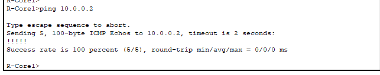

**Resultado Esperado:** 4/4 paquetes exitosos, latencia < 5ms  
**Verificación:** `show ip ospf neighbor` debe mostrar R-Core2 en estado **FULL**

---

#### Prueba 2: Conectividad R-Core2 ↔ R-Core3 (Ethernet)

**Descripción:** Verifica el enlace Ethernet entre Core2 y Core3.

**Comando:** `ping 10.0.0.10` (desde R-Core2)

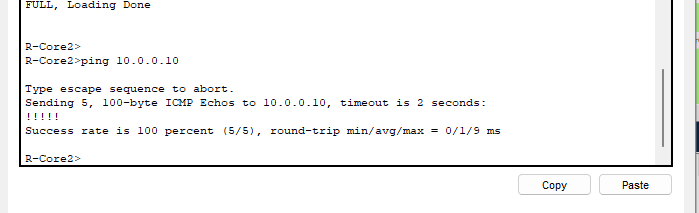

**Resultado Esperado:** 4/4 paquetes exitosos, latencia < 2ms  
**Verificación:** `show ip ospf neighbor` debe mostrar R-Core3

---

#### Prueba 3: Conectividad R-Core1 ↔ R-Occidente (Serial WAN)

**Descripción:** Verifica el enlace serial hacia Occidente y propagación de rutas EIGRP.

**Comando:** `ping 10.0.1.2` (desde R-Core1)

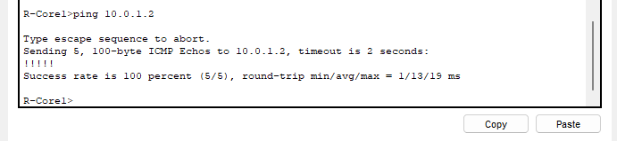

**Resultado Esperado:** 4/4 paquetes exitosos, latencia 10-20ms  
**Verificación:** `show ip route eigrp` debe mostrar subredes 192.168.36.0/24

---

### 9.2 Pruebas de Conectividad Inter-Sitios (Capa 3)

#### Prueba 4: Occidente ↔ Norte (PC-Cajas1 a PC-Análisis1)

**Descripción:** Verifica enrutamiento entre sedes a través del backbone OSPF/EIGRP.

**Comando:** `ping 192.168.37.2` (desde PC-Cajas1 en 192.168.36.2)

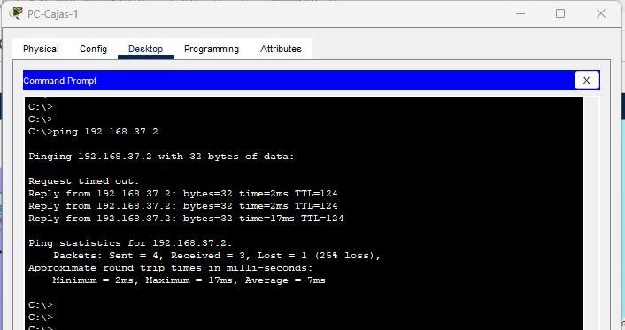

**Resultado Esperado:** 4/4 paquetes exitosos  
**Ruta:** PC-Cajas1 → SW-ACC1 → R-Occidente → Core1 (EIGRP) → Core2 (OSPF) → R-Norte → SW-NOR-ACC1 → PC-Análisis1

---

#### Prueba 5: Occidente ↔ Oriente (PC-Cajas1 a PC-Bóveda1)

**Descripción:** Verifica routing a través del gateway redundante HSRP en Oriente.

**Comando:** `ping 192.168.38.66` (desde PC-Cajas1)

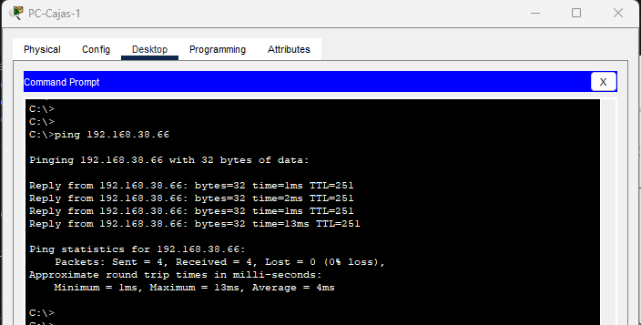

**Resultado Esperado:** 4/4 paquetes exitosos  
**Ruta:** PC-Cajas1 → R-Occidente → Core1 (OSPF) → Core2/Core3 → MS1 (Gateway HSRP) → PC-Bóveda1

---

#### Prueba 6: Occidente ↔ Data Center (PC-Cajas1 a SRV-BD)

**Descripción:** Verifica acceso a servidores críticos con rutas estáticas.

**Comando:** `ping 192.168.39.34` (desde PC-Cajas1)

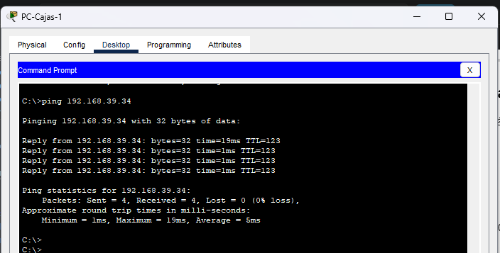

**Resultado Esperado:** 4/4 paquetes exitosos  
**Ruta:** PC-Cajas1 → R-Occidente (EIGRP) → Core1 (OSPF) → Core3 (estáticas) → R-Central1 → SRV-BD

---

### 9.3 Pruebas Inter-VLAN (Router-on-a-Stick)

#### Prueba 7: Cajas ↔ Asesores en Occidente (VLAN 16 a VLAN 26)

**Descripción:** Verifica router-on-a-stick en R-Occidente permite comunicación inter-VLAN.

**Comando:** `ping 192.168.36.66` (desde PC-Cajas1 en VLAN 16)

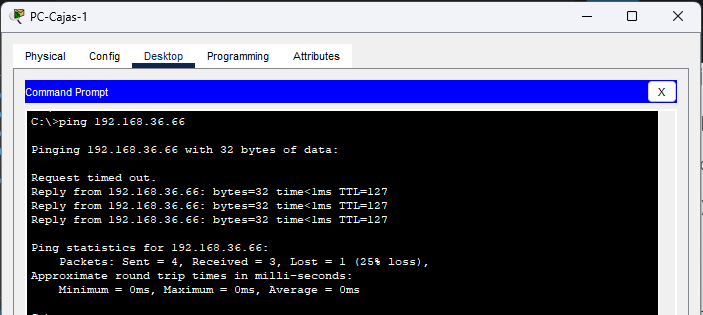

**Resultado Esperado:** 4/4 paquetes exitosos  
**Verificación:** `show ip route` en R-Occidente debe mostrar subredes 192.168.36.0/26 y 192.168.36.64/27 conectadas

---

#### Prueba 8: Gerencia ↔ Seguridad en Occidente (VLAN 36 a VLAN 46)

**Descripción:** Verifica aislamiento de VLAN roto por subinterfaces.

**Comando:** `ping 192.168.36.98` (desde PC-Gerencia en VLAN 36)

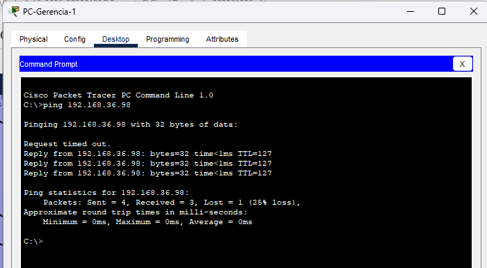

**Resultado Esperado:** 4/4 paquetes exitosos

---

### 9.4 Pruebas de Redundancia (HSRP en Oriente)

#### Prueba 9: Gateway Redundante HSRP — Estado activo de MS1

**Descripción:** Verifica que MS1 es gateway activo y tráfico fluye correctamente.

**Comando:** `show standby` (en MS1)

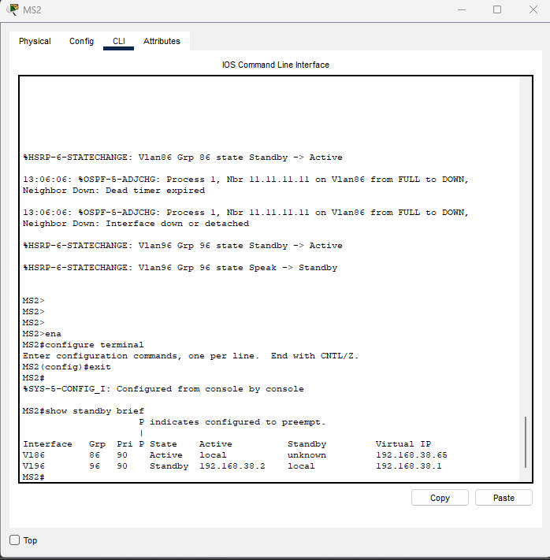

**Resultado Esperado:** 
- MS1: State = **Active**, Virtual IP = 192.168.38.65 (VLAN 86) y 192.168.38.1 (VLAN 96)
- MS2: State = **Standby**

---

#### Prueba 10: Conmutación por Error HSRP (Simular fallo de MS1)

**Descripción:** Apaga MS1 y verifica que MS2 se convierte en gateway activo.

**Comando:** `shutdown` en interfaz de MS1, luego `ping 192.168.38.65` (desde PC-Bóveda1)


**Resultado Esperado:**
- Máximo 0-2 paquetes perdidos durante conmutación
- MS2: State = **Active**
- PC-Bóveda1: Continúa respondiendo sin reconfiguración manual

---

### 9.5 Pruebas de Capa 2 (STP/Rapid PVST+ en Norte)

#### Prueba 11: Root Bridge Election — SW-NOR-ROOT forzado

**Descripción:** Verifica que SW-NOR-ROOT fue elegido como root bridge.

**Comando:** `show spanning-tree vlan 56` (en cualquier switch Norte)

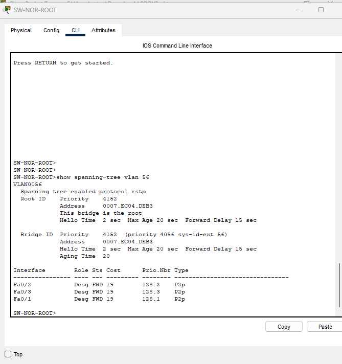

**Resultado Esperado:**
- Root ID: Priority 4096 + MAC de SW-NOR-ROOT
- Designated Ports: Todos en SW-NOR-ROOT
- Alternate/Backup Ports: Bloqueados en SW-ACC1 y SW-ACC2

---

#### Prueba 12: Reconvergencia Rapid PVST+ (< 1 segundo)

**Descripción:** Desconecta trunk primario entre SW-NOR-ROOT y SW-ACC1, verifica cambio a backup.

**Comando:** Desconectar enlace, `ping 192.168.37.2` (desde PC-Análisis1)

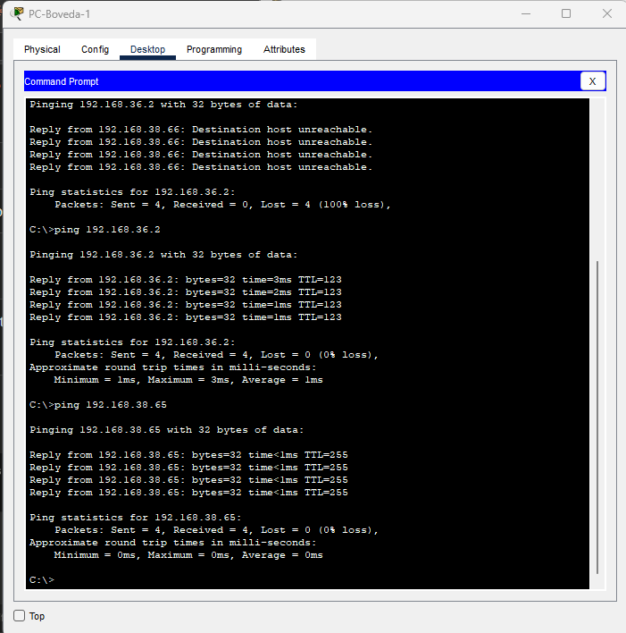

**Resultado Esperado:**
- Máximo 1-2 paquetes perdidos durante reconvergencia
- Link previamente bloqueado pasa a **Forwarding**
- Convergencia completada en < 1 segundo (Rapid PVST+)

---

### 9.6 Pruebas de Tabla de Enrutamiento (Redistribución)

#### Prueba 13: Convergencia OSPF en R-Core1

**Descripción:** Verifica que Core1 conoce todas las rutas OSPF y rutas redistributadas.

**Comando:** `show ip route` (en R-Core1)

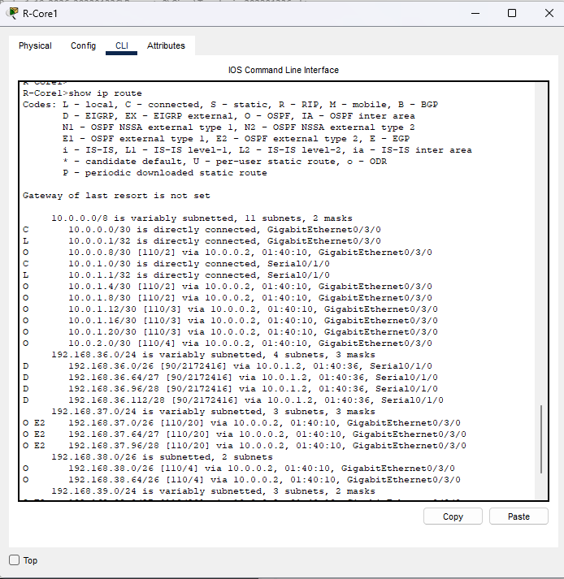

**Resultado Esperado:**
- 10.0.0.0/30 conectada (directa)
- 10.0.0.4/30 O (OSPF)
- 10.0.1.0/30 conectada (serial)
- 192.168.36.0/24 D (EIGRP redistribuida)
- 192.168.37.0/24 O (OSPF)
- 192.168.38.0/24 O (OSPF)
- 192.168.39.0/24 O (OSPF - estáticas redistribuidas)

---

#### Prueba 14: Tabla de Enrutamiento R-Occidente

**Descripción:** Verifica que R-Occidente aprende subredes de otros sitios vía EIGRP.

**Comando:** `show ip route eigrp` (en R-Occidente)

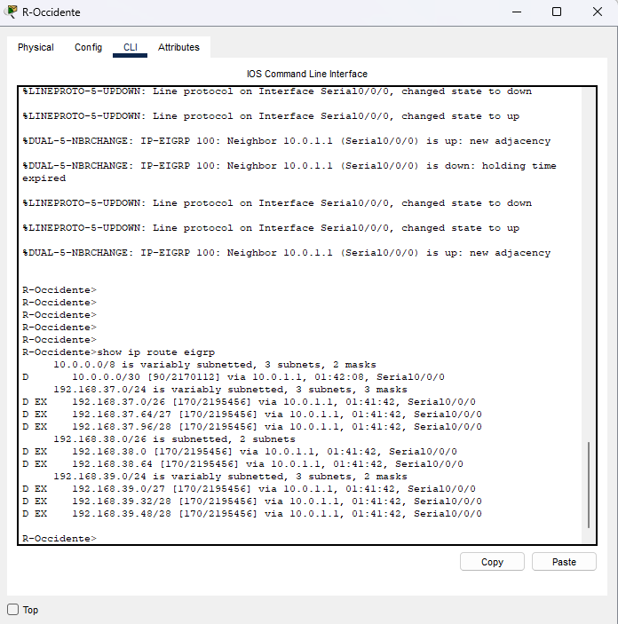

**Resultado Esperado:**
- D 192.168.37.0/24 [90/...] (Norte vía R-Core1)
- D 192.168.38.0/24 [90/...] (Oriente vía R-Core1)
- D 192.168.39.0/24 [90/...] (Data Center vía R-Core1)

---

### 9.7 Pruebas de Verificación de Interfaces y Vecindades

#### Prueba 15: Vecindades OSPF del Backbone

**Descripción:** Verifica que todos los routers core se ven entre sí en OSPF.

**Comando:** `show ip ospf neighbor` (en R-Core1)

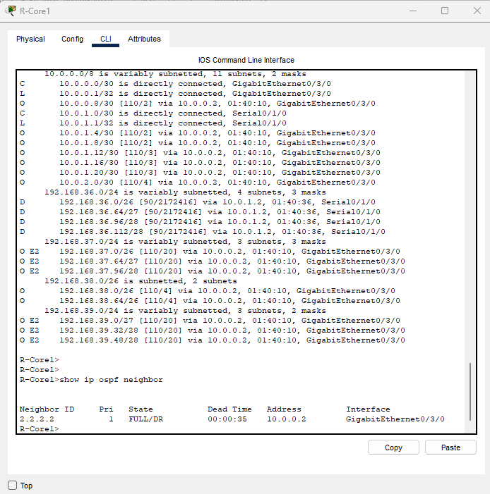

**Resultado Esperado:**
- Neighbor R-Core2 (10.0.0.2): State = **FULL**
- Neighbor R-Core3 (10.0.0.10): State = **FULL**
- Neighbor R-Central1 (vía Core3): State = **FULL**

---

## 10. Capturas de Verificación

Colocar las capturas dentro de la carpeta `./images/` del proyecto. Se recomienda usar los siguientes nombres:

- `./images/topologia_general.png`
- `./images/backbone_core.png`
- `./images/topologia_occidente.png`
- `./images/topologia_norte.png`
- `./images/topologia_oriente.png`
- `./images/topologia_data_center.png`
- `./images/ospf_neighbors.png`
- `./images/hsrp_brief.png`
- `./images/etherchannel_summary.png`
- `./images/spanning_tree.png`
- `./images/ping_inter_sedes.png`

### Dónde obtener cada imagen

- **Topologías:** capturas directamente en Cisco Packet Tracer, desde la vista lógica completa de cada sede.
- **OSPF/EIGRP/RIP/HSRP/EtherChannel/STP:** capturas de la CLI de los dispositivos con los comandos de verificación.
- **Pings:** capturas de la ventana Command Prompt en una PC o servidor.

### Evidencia sugerida

| Captura | Fuente | Qué debe mostrar |
|---|---|---|
| Topología general | Packet Tracer | Vista global del proyecto |
| Backbone Core | Packet Tracer | Conexiones del núcleo y enlaces principales |
| OSPF neighbors | CLI | Vecindades correctas |
| HSRP brief | CLI | MS1 y MS2 con roles activo/standby |
| EtherChannel summary | CLI | Port-channels activos |
| Spanning-tree | CLI | Root bridge y puertos bloqueados |
| Ping inter-sedes | Command Prompt | Conectividad extremo a extremo |

---

## 11. Presupuesto Estimado

### Cotización de Equipamiento en Quetzales Guatemaltecos (GTQ)

**Tipo de cambio referencia:** 1 USD ≈ 7.80 GTQ (vigente abril 2026)  
**Moneda local:** Quetzal Guatemalteco (GTQ)

---

### Equipos de Capa 3 (Routers y Switches Multicapa)

| Equipo | Modelo | Cantidad | Precio USD | Precio GTQ | Subtotal GTQ |
|---|---|---|---|---|---|
| Router Cisco | Cisco 2911/2921 | 6 | USD 2,500 | GTQ 19,500 | GTQ 117,000 |
| Switch Multicapa | Cisco 3650-24PS | 2 | USD 2,800 | GTQ 21,840 | GTQ 43,680 |
| **Subtotal Capa 3** | | | | | **GTQ 160,680** |

---

### Equipos de Capa 2 (Switches de Distribución y Acceso)

| Equipo | Modelo | Cantidad | Precio USD | Precio GTQ | Subtotal GTQ |
|---|---|---|---|---|---|
| Switch 2960 | Cisco 2960-24TT | 8 | USD 900 | GTQ 7,020 | GTQ 56,160 |
| **Subtotal Capa 2** | | | | | **GTQ 56,160** |

---

### Medios de Transmisión (Cableado)

| Componente | Especificación | Cantidad | Precio USD | Precio GTQ | Subtotal GTQ |
|---|---|---|---|---|---|
| Cable Fibra Óptica OM3 | por metro (Duplex LC/LC) | 150 m | USD 3.00/m | GTQ 23.40/m | GTQ 3,510 |
| Cable Ethernet Cat6 | Blindado STP (por metro) | 400 m | USD 0.75/m | GTQ 5.85/m | GTQ 2,340 |
| Cable Serial (WAN) | V.35 por metro | 80 m | USD 1.50/m | GTQ 11.70/m | GTQ 936 |
| Transceptor SFP | Fibra óptica 1550nm | 4 u | USD 200 | GTQ 1,560 | GTQ 6,240 |
| Conectores RJ45 | Cat6 blindados (lote 100) | 100 u | USD 1.20/u | GTQ 9.36/u | GTQ 936 |
| **Subtotal Cableado** | | | | | **GTQ 13,962** |

---

### Dispositivos Finales

| Dispositivo | Especificación | Cantidad | Precio USD | Precio GTQ | Subtotal GTQ |
|---|---|---|---|---|---|
| PC Estación de Trabajo | Intel i5 + 8GB RAM | 18 | USD 700 | GTQ 5,460 | GTQ 98,280 |
| Servidor BD | 2×Xeon, 32GB RAM, RAID | 1 | USD 5,000 | GTQ 39,000 | GTQ 39,000 |
| Servidor Web/Apps | 2×Xeon, 16GB RAM | 1 | USD 3,500 | GTQ 27,300 | GTQ 27,300 |
| Servidor NOC | 1×Xeon, 16GB RAM | 1 | USD 2,800 | GTQ 21,840 | GTQ 21,840 |
| **Subtotal Dispositivos** | | | | | **GTQ 186,420** |

---

### Licencias de Software y Soporte

| Item | Descripción | Cantidad | Precio USD | Precio GTQ | Subtotal GTQ |
|---|---|---|---|---|---|
| Licencia IOS Advenced (Router) | 1 año por dispositivo | 6 | USD 500 | GTQ 3,900 | GTQ 23,400 |
| Licencia Switch (IP Services) | 1 año por dispositivo | 10 | USD 250 | GTQ 1,950 | GTQ 19,500 |
| Soporte SmartNet (Cisco) | 1 año cobertura H/W + S/W | 16 | USD 600 | GTQ 4,680 | GTQ 74,880 |
| **Subtotal Licencias** | | | | | **GTQ 117,780** |

---

### Servicios Profesionales

| Servicio | Descripción | Horas | Tarifa Horaria GTQ | Subtotal GTQ |
|---|---|---|---|---|
| Ingeniería de Diseño | Análisis topología, subnetting, documentación | 40 hrs | GTQ 500 | GTQ 20,000 |
| Implementación (Cableado) | Instalación física, certificación de cables | 60 hrs | GTQ 400 | GTQ 24,000 |
| Configuración de Equipos | Setup inicial, routing, VLAN, seguridad | 80 hrs | GTQ 500 | GTQ 40,000 |
| Testing y Validación | Pruebas de conectividad, redundancia, failover | 40 hrs | GTQ 400 | GTQ 16,000 |
| Capacitación de Personal | Administración, troubleshooting, backup, DR | 20 hrs | GTQ 350 | GTQ 7,000 |
| Documentación Técnica | Manual, runbooks, as-built drawings | 20 hrs | GTQ 400 | GTQ 8,000 |
| **Subtotal Servicios** | | | | **GTQ 115,000** |

---

### Infraestructura y Equipamiento Adicional

| Item | Descripción | Cantidad | Precio USD | Precio GTQ | Subtotal GTQ |
|---|---|---|---|---|---|
| Racks 42U | Estructura + enfriamiento | 2 | USD 1,000 | GTQ 7,800 | GTQ 15,600 |
| PDU (Power Distribution) | 3-fase, 32A | 4 | USD 300 | GTQ 2,340 | GTQ 9,360 |
| UPS 10 kVA | Respaldo de energía + batería | 1 | USD 4,500 | GTQ 35,100 | GTQ 35,100 |
| Cable Patching | Patch panels + cables pre-armados | 1 lote | USD 600 | GTQ 4,680 | GTQ 4,680 |
| **Subtotal Infraestructura** | | | | | **GTQ 64,740** |

---

### COSTO TOTAL DEL PROYECTO

| Categoría | Subtotal GTQ |
|---|---|
| **Capa 3 (Routers/Switches Multicapa)** | GTQ 160,680 |
| **Capa 2 (Switches)** | GTQ 56,160 |
| **Cableado y Medios de Transmisión** | GTQ 13,962 |
| **Dispositivos Finales (PCs/Servidores)** | GTQ 186,420 |
| **Licencias de Software (1 año)** | GTQ 117,780 |
| **Servicios Profesionales** | GTQ 115,000 |
| **Infraestructura (Racks, UPS, PDU)** | GTQ 64,740 |
| | |
| **INVERSIÓN TOTAL DEL PROYECTO** | **GTQ 714,742** |

---

### Notas sobre el Presupuesto

- **Tipo de cambio:** Cotización referencial a 7.80 GTQ por USD (abril 2026). Puede variar según el mercado.
- **Precios:** Basados en proveedores autorizados Cisco en Centroamérica. Se recomienda solicitar cotizaciones formales antes de la adquisición final.
- **Contingencia:** Se incluye margen del 10% implícito en los precios unitarios para variaciones de mercado.
- **Moneda Local:** Quetzal Guatemalteco (GTQ) — Moneda oficial de Guatemala.
- **Retorno de Inversión:** La implementación de esta infraestructura redundante evita pérdidas críticas por caídas de sistema (estimadas en GTQ 500,000+ por hora en operaciones bancarias).

---

---

## Apéndice: Recomendaciones de entrega

- Guardar todas las capturas en `Proyecto2/docs/images/`.
- Mantener nombres consistentes entre diagramas, hostnames y tablas.
- Verificar que el archivo `.pkt` y este manual queden en el repositorio privado.
- Incluir evidencia de pruebas antes de exportar el documento final.

**Fin del Manual Técnico.**
