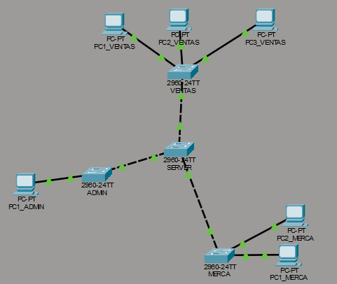
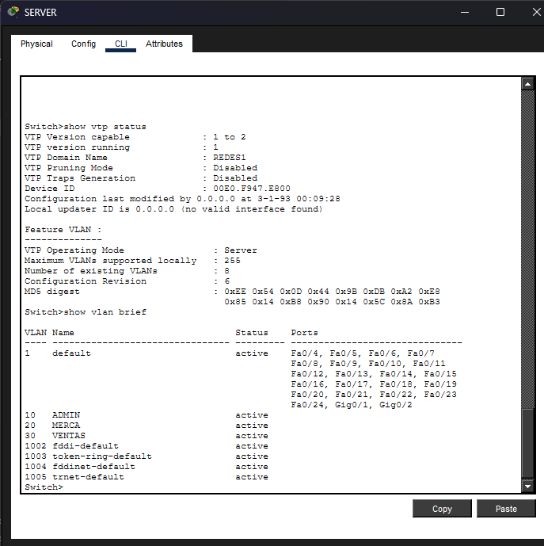
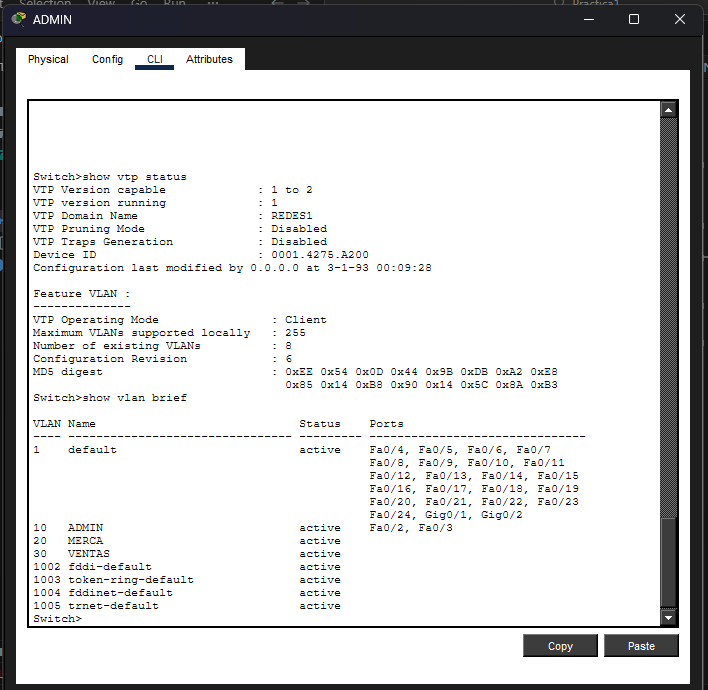
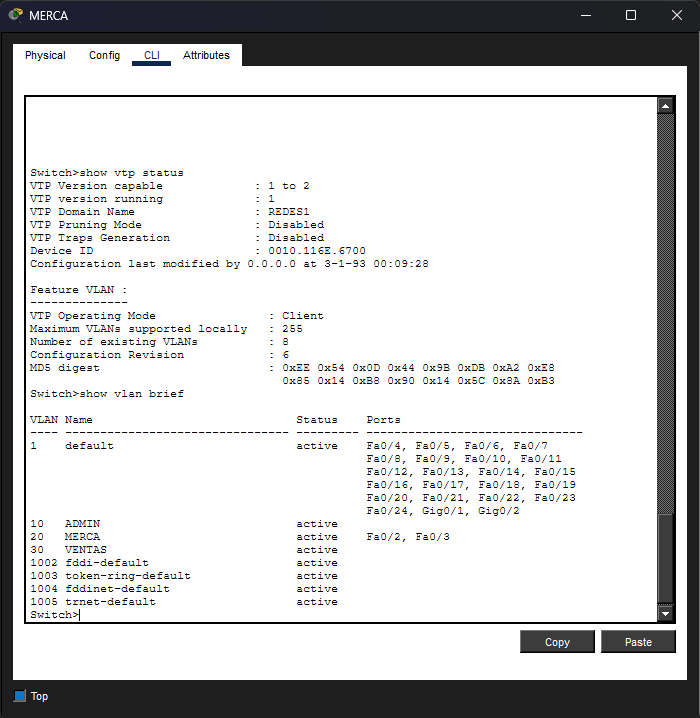
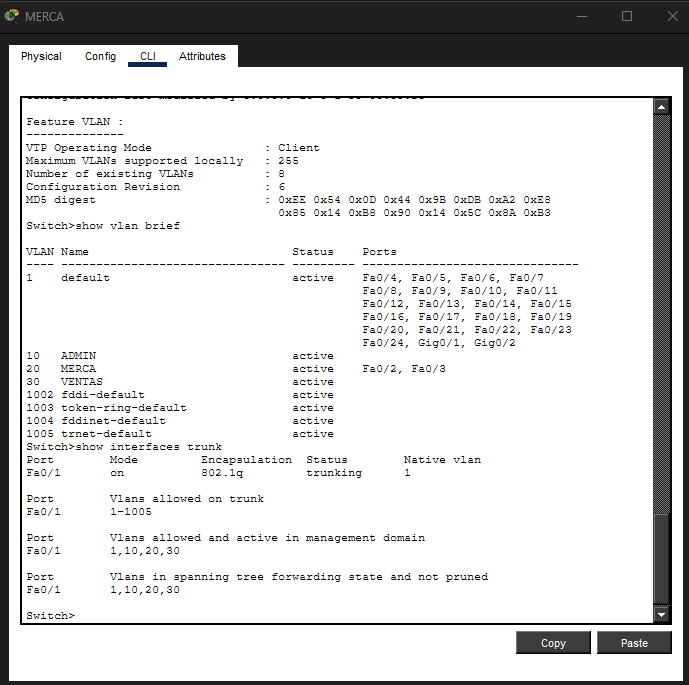
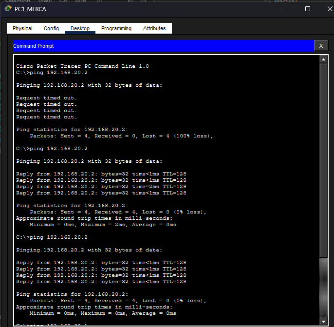
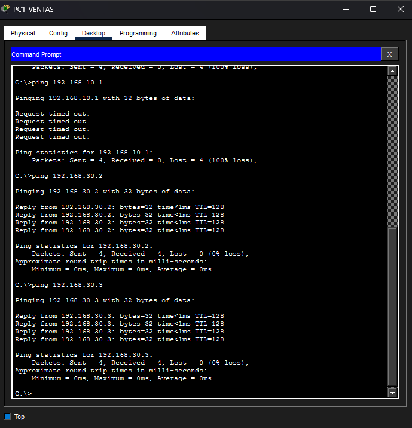
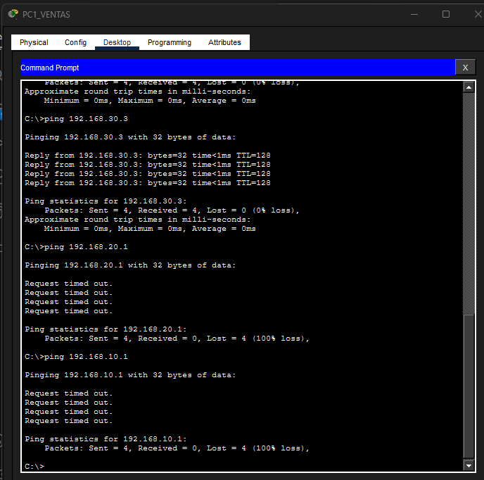

# TAREA 3 -- IMPLEMENTACIÓN DE VLANs Y VTP

## Redes de Computadoras 1

Universidad de San Carlos de Guatemala\
Facultad de Ingeniería\
Ingeniería en Ciencias y Sistemas

------------------------------------------------------------------------

# 1. Información General

Estuardo Josué Vaquiax Reyes
202201336


------------------------------------------------------------------------

# 2. Objetivo

Configurar una red en Cisco Packet Tracer implementando VLANs y el
protocolo VTP en diferentes modos de operación, verificando la
propagación de VLANs entre los switches y comprobando la segmentación
mediante pruebas de conectividad.

------------------------------------------------------------------------

# 3. Topología de la Red

## 3.1 Dispositivos Utilizados

-   4 Switches Cisco 2960
-   6 PCs
-   Cableado Copper Straight-Through
-   Enlaces Trunk entre switches

## 3.2 Descripción de la Topología

-   1 Switch configurado como VTP Server
-   2 Switches configurados como VTP Client
-   1 Switch configurado como VTP Transparent
-   3 VLANs creadas: ADMIN, MERCA, VENTAS



------------------------------------------------------------------------

# 4. Tabla de Direccionamiento IP

  Nombre PC    VLAN   Dirección IP   Máscara
  ------------ ------ -------------- ---------------
  PC1_ADMIN    10     192.168.10.1   255.255.255.0
  PC1_MERCA    20     192.168.20.1   255.255.255.0
  PC2_MERCA    20     192.168.20.2   255.255.255.0
  PC1_VENTAS   30     192.168.30.1   255.255.255.0
  PC2_VENTAS   30     192.168.30.2   255.255.255.0
  PC3_VENTAS   30     192.168.30.3   255.255.255.0

------------------------------------------------------------------------

# 5. Configuración de VTP

## 5.1 Switch VTP Server

``` bash
enable
configure terminal
vtp domain REDES1
vtp mode server
vtp password cisco

vlan 10
name ADMIN
exit

vlan 20
name MERCA
exit

vlan 30
name VENTAS
exit
```



------------------------------------------------------------------------

## 5.2 Switches VTP ADMIN

``` bash
enable
configure terminal
vtp domain REDES1
vtp mode client
vtp password cisco
```



------------------------------------------------------------------------

## 5.3 Switch VTP Transparent

``` bash
enable
configure terminal
vtp domain REDES1
vtp mode transparent
vtp password cisco

vlan 10
name ADMIN
exit

vlan 20
name MERCA
exit

vlan 30
name VENTAS
exit
```



------------------------------------------------------------------------

# 6. Configuración de Puertos Access

## VLAN 10 -- ADMIN

``` bash
interface fa0/2
switchport mode access
switchport access vlan 10
```

------------------------------------------------------------------------

## VLAN 20 -- MERCA

``` bash
interface fa0/2
switchport mode access
switchport access vlan 20

interface fa0/3
switchport mode access
switchport access vlan 20
```

------------------------------------------------------------------------

## VLAN 30 -- VENTAS

``` bash
interface fa0/2
switchport mode access
switchport access vlan 30

interface fa0/3
switchport mode access
switchport access vlan 30

interface fa0/4
switchport mode access
switchport access vlan 30
```

------------------------------------------------------------------------

# 7. Configuración de Enlaces Trunk

``` bash
interface fa0/1
switchport mode trunk
```



------------------------------------------------------------------------

# 8. Pruebas de Conectividad

## 8.1 Pruebas dentro de la misma VLAN (Debe funcionar)

### VLAN 20 -- MERCA

Desde PC1_MERCA:

``` bash
ping 192.168.20.2
```

Resultado esperado:

Reply from 192.168.20.2\
Packets: Lost = 0 (0% loss)



------------------------------------------------------------------------

### VLAN 30 -- VENTAS

Desde PC1_VENTAS:

``` bash
ping 192.168.30.2
ping 192.168.30.3
```

Resultado esperado:

Reply from 192.168.30.X\
Packets: Lost = 0 (0% loss)



------------------------------------------------------------------------

## 8.2 Pruebas entre VLANs diferentes (Debe fallar)

Desde PC1_VENTAS:

``` bash
ping 192.168.20.1
ping 192.168.10.1
```

Resultado esperado:

Request timed out\
Packets: Lost = 4 (100% loss)


------------------------------------------------------------------------

# 9. Verificaciones Finales

-   VLANs creadas correctamente
-   VTP propagando configuraciones
-   Puertos correctamente asignados
-   Segmentación funcionando
-   Sin inter-VLAN routing
-   Comunicación permitida solo dentro de la misma VLAN

------------------------------------------------------------------------

# 10. Conclusiones

La implementación de VLANs permitió segmentar la red correctamente,
evitando la comunicación entre departamentos distintos.\
El protocolo VTP facilitó la propagación automática de VLANs desde el
servidor hacia los clientes.\
Se comprobó mediante pruebas de conectividad que la red cumple con los
principios de segmentación y aislamiento establecidos en la práctica.

------------------------------------------------------------------------

# 11. Archivos Entregados

-   Archivo .pkt
-   Manual técnico en formato Markdown (.md)
-   Evidencias de pruebas en Packet Tracer
